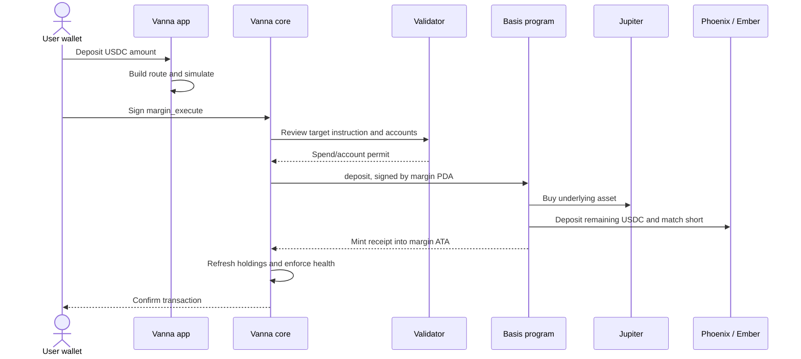

# Vanna Farm: Basis aur Perena vaults ka detailed working guide

**Initial review: 9 October 2026. PDF/UI audit updated: 10 October 2026 (IST). Language: Hinglish.**

**Latest screenshot ke liye [section 15](#15-10-october-audit-screenshot-values-ka-source-aur-pdf-comparison) padhein.** Current UI missing APY ko `0.00%` render karti hai; ye measured zero return nahi. PDF ke saare analytics/fallbacks abhi implement nahi hue hain. Neeche contract explanation aur latest UI audit ko alag rakha gaya hai.

Ye guide current local integration aur contracts ko explain karti hai: paisa kahan jata hai, kaunse instructions execute hote hain, shares kaise calculate hote hain, aur withdrawal mein kya hota hai. Examples educational calculations hain; future transaction quotes ya returns nahi.

Environment `https://rpc-devnet.solana.vanna.finance` ek **Surfpool mainnet fork** hai. URL mein “devnet” hone se ye public Solana devnet nahi ban jata. Deployment/test evidence [integration status](VAULT_INTEGRATION_STATUS.md) mein hai. Is documentation task mein deployment nahi kiya gaya.

## 1. Pehle dono products ka difference

| Feature | Vanna Basis vault | Perena USD* | Perena USD* Junior |
| --- | --- | --- | --- |
| Strategy | Ek asset hold + matching Phoenix short | Perena ka managed yield portfolio | Perena portfolio ka first-loss tranche |
| Vanna mein input | USDC | USDC | USDC |
| Receipt | vbSOL / vbETH / vbBTC / vbTSLA / vbMETA | USD* | USD* Junior |
| Return ka mechanism | Funding aur overall strategy P&L se share NAV change | Portfolio returns se receipt price change | Different yield allocation aur first-loss exposure se tranche price change |
| Withdrawal | Shares redeem karke USDC | Shares redeem karke USDC | Current integration mein instant shares-to-USDC redemption |
| Strategy execution | Local Basis program → Jupiter + Phoenix | External Perena program | External Perena program, Junior selector |

**Receipt token ownership proof hai.** `1 vbSOL = 1 SOL` nahi hai. Isi tarah `USD*` ka naam hone se har receipt ki price exactly $1 nahi hoti.

Terms:

- **NAV:** assets aur liabilities ko value karne ke baad vault ki net dollar value.
- **Share price:** ek receipt ki accounting value.
- **CPI:** ek Solana program ka doosre program ko instruction call karna.
- **PDA:** program-controlled address; user private key wala wallet nahi.
- **ATA:** kisi owner aur mint ka associated token account.
- **Funding:** perpetual longs/shorts ke beech periodic payment; sign badal sakta hai.
- **bps:** 100 basis points = 1%; 50 bps = 0.5%.

## 2. Contracts aur responsibilities

| Program | Current address | Kaam |
| --- | --- | --- |
| Vanna credit layer | `H37YVBG3eGtz89ofd7iDLc2PJgn12778392XeU2QJcGC` | Margin custody, authorized external calls, debt/health checks |
| Vanna validator | `6fND3vhtstp486iE6rsSNVUox3kcjNNRsSLAN7ZPs7th` | Allowed instruction, account bindings aur maximum spend review |
| Vanna oracle | `FXY5DRfekMUTbUp4uyCFpCZmCccrp6kPq3hTM4GRihnc` | Receipt collateral valuation |
| Basis vault | `GtuQoYxzytGKtLqQGkYrVbsaPHTZN5jboP25DrSmKvGr` | Deposit, withdraw, hedge, rebalance, receipt mint/burn |
| Jupiter v6 | `JUP6LkbZbjS1jKKwapdHNy74zcZ3tLUZoi5QNyVTaV4` | USDC ↔ underlying asset routing |
| Phoenix perpetuals | `EtrnLzgbS7nMMy5fbD42kXiUzGg8XQzJ972Xtk1cjWih` | Short position, collateral, funding, margin rules |
| Perena | `save8RQVPMWNTzU18t3GBvBkN9hT7jsGjiCQ28FpD9H` | USD* and Junior issuance/redemption |

Phoenix adapter Ember ke through USDC/canonical collateral conversion aur Hawkeye ke through margin/asset views use karta hai. Ye Phoenix perpetuals integration hai; spot-only Phoenix orderbook samajhna galat hoga.

Har vault ke exact account, receipt mint, underlying mint aur lookup table [vault catalogue](../lib/solana/vault-catalogue.ts) mein hain. PDF ka old credit-layer address use nahi karna.

## 3. Delta-neutral ka actual meaning

Vault underlying asset own karta hai aur approximately utni hi quantity short karta hai:

```text
Net directional exposure ≈ long asset quantity − short equivalent quantity
Price-change P&L ≈ long gain/loss + short gain/loss
```

Price badhne par held asset gain karta hai, short loss karta hai. Price girne par iska reverse hota hai. Ideally dono offset hote hain. Vault ka aim funding capture karna hai; asset price badhne ki bet lena nahi.

Actual neutrality exact nahi hoti: Phoenix lot rounding, spot/perp price difference, fees, funding, xStock multipliers aur execution timing residual exposure create kar sakte hain. Delta-neutral ka matlab principal guarantee ya zero liquidation risk nahi.

### 3.1 SOL aur baaki assets mein capital allocation alag hai

Contract formula:

```text
swap_USDC_raw = floor(deposit_USDC_raw × 10,000 / (10,000 + target_margin_bps))
remaining_USDC = deposit_USDC_raw − actual_swap_spend
```

| Vault kind | Target example | USDC ka use |
| --- | ---: | --- |
| Native SOL | 0 bps | Poora deposit SOL kharidta hai; wahi SOL Phoenix collateral banta hai |
| ETH/BTC/TSLA/META spot | 10,000 bps | Approximately half underlying tokens, half Phoenix USDC collateral |

Split configuration-driven hai, universal immutable 50/50 rule nahi. Source: [swap sizing](../../basis-trading-solana/programs/vanna_phoenix_vault/src/swap.rs).

### 3.2 ETH example: 1,000 USDC deposit

Assume ETH = $2,000, target 10,000 bps, fees/slippage zero:

1. 500 USDC se **0.25 ETH** buy hota hai.
2. Ye ETH vault-authority token account mein rehta hai.
3. Remaining 500 USDC Phoenix margin mein jata hai.
4. Phoenix par **0.25 ETH short** open hota hai, initial notional $500.

| ETH price | Held ETH value | Short P&L | Phoenix equity including initial $500 | Combined NAV |
| --- | ---: | ---: | ---: | ---: |
| $2,000 | $500 | $0 | $500 | $1,000 |
| $2,400 | $600 | −$100 | $400 | $1,000 |
| $1,600 | $400 | +$100 | $600 | $1,000 |

Ye idealized accounting hai. Price rise par total NAV stable ho sakti hai, phir bhi Phoenix mein available margin kam hoti hai. Isi liye margin monitoring/rebalance zaroori hai.

### 3.3 SOL example: 1,000 USDC deposit

Assume SOL = $100, costs zero:

1. 1,000 USDC → 10 SOL.
2. Native 10 SOL Phoenix collateral mein post hote hain.
3. 10 SOL short open hota hai, notional $1,000.
4. SOL $120 hone par collateral economic value $1,200 aur short P&L −$200: net $1,000.

SOL ka collateral contribution Phoenix haircuts/risk rules se determine hota hai. Economic value aur **effective margin value** same number nahi hain. Negative USDC equity, margin restrictions aur liquidation rules ko net-zero delta override nahi karta.

## 4. Basis deposit: exact transaction flow

### 4.1 ETH/BTC/TSLA/META — margin account flow



Outer core instruction:

```text
margin_execute(data, call_account_count)
```

Basis target instruction:

```text
deposit(gti, atb, usdc_amount, min_shares, route)
```

`gti`/`atb` Phoenix index/buffer account counts hain, trading amounts nahi. `route` Jupiter instruction data aur account count carry karta hai.

Basis contract sequence:

1. Pause/deposit-open rules aur market conditions validate karta hai.
2. Pre-trade NAV, supply, Phoenix equity aur short notional read karta hai.
3. User ke margin USDC account se vault account mein transfer karta hai.
4. Jupiter swap karta hai; actual balances se spent/received amounts check karta hai.
5. Remaining USDC ko Ember/Phoenix collateral path se deposit karta hai.
6. Actual held asset ke according short adjust karta hai.
7. Post-trade caps, margin condition aur incremental NAV check karta hai.
8. Calculated shares mint karta hai, `min_shares` enforce karta hai, `Deposited` event emit karta hai.
9. Vanna updated holdings value karke execution health enforce karta hai.

Same transaction ke kisi step mein failure aaye to us transaction ke state changes revert hote hain; failed transaction network fee lag sakti hai.

Sources: [app builder](../lib/solana/vault-actions.ts), [core execution](../../vanna-credit-layer/programs/vanna_credit_layer/src/instructions/account_manager/exec.rs), [Basis deposit](../../basis-trading-solana/programs/vanna_phoenix_vault/src/instructions/deposit.rs).

### 4.2 SOL Basis — two transactions kyun?

Current deployed path:

```text
Transaction 1:
Wallet USDC → Basis.deposit → Jupiter wSOL → native SOL into Phoenix
→ matching short → vbSOL minted into wallet

Transaction 2:
Vanna.user_deposit_collateral → wallet vbSOL moved into margin ATA
```

Phoenix native-SOL trader allocation path ko system-transfer-compatible payer chahiye. Data-bearing margin PDA us wallet role ko satisfy nahi karta; integration wallet-funded deposit use karti hai.

Isliye SOL Basis ke liye **wallet mein USDC** chahiye; margin USDC automatically spend nahi hota. Transaction 1 successful aur transaction 2 reject/fail ho to deposit undo nahi hota: shares wallet mein rehte hain. **Move shares to margin** se second step complete ho sakta hai.

Ye do financial approvals hain; first-use account/lookup-table setup ki separate approval bhi possible hai. Source: [submit and recovery flow](../lib/solana/vault-actions.ts).

## 5. Basis NAV aur receipt calculation

### 5.1 NAV kya count karti hai?

```text
asset_value = held_asset_units × Phoenix mark-based token price
Phoenix_equity = USDC-side collateral + unrealized P&L + unsettled funding
NAV = max(asset_value + Phoenix_equity, 0)
```

SOL case mein native SOL `asset_value` mein count hota hai; use dobara USDC-side equity mein add nahi karna. Phoenix ka haircut-based effective collateral health ke liye alag measure hai.

USDC/NAV aur receipts 6 decimals use karte hain: 1 USDC = 1,000,000 raw units; 1 vbETH = 1,000,000 raw shares. SOL underlying 9 decimals hai. xStocks ke token units aur market shares multiplier se reconcile hote hain.

### 5.2 Exact mint formula: nominal deposit se different

Raw integer quantities mein:

```text
VIRTUAL_USD = 1,000,000      // $1
VIRTUAL_SHARES = 1,000,000   // 1 whole receipt
added_value = max(NAV_after − NAV_before, 0)

new_shares_raw = floor(
  added_value × (supply_before_raw + VIRTUAL_SHARES)
  / (NAV_before_raw + VIRTUAL_USD)
)
```

**Apne deposit ki execution cost depositor carry karta hai.** 1,000 USDC transfer karne ka matlab exactly $1,000 NAV add hona nahi.

Example: existing NAV $10,000, existing supply 10,000 receipts. Deposit 1,000 USDC, apni execution se $2 cost:

```text
NAV_after = $10,998
added_value = $998
new_shares = 998 × (10,000 + 1) / (10,000 + 1) = 998 receipts
```

Initial empty vault mein net $998 add hua to 998 shares milenge. Virtual $1/share offset first price establish aur share-price manipulation/rounding attacks reduce karta hai.

SDK displayed share price bhi adjusted formula use karta hai:

```text
price_raw = floor(1,000,000 × (NAV_raw + 1,000,000) / (supply_raw + 1,000,000))
displayed_USD_price = price_raw / 1,000,000
```

Bade vault mein ye NAV/supply ke bahut close hai. Tiny vault mein virtual offset meaningful hai; rounded UI TVL ko rounded price se divide karke exact mint supply recover nahi kar sakte.

Sources: [Rust math](../../basis-trading-solana/programs/vanna_phoenix_vault/src/math.rs), [NAV math](../../basis-trading-solana/programs/vanna_phoenix_vault/src/nav.rs), [SDK pricing](../../basis-trading-solana/client/src/math.ts).

## 6. Basis withdrawal aur partial payout

All current vault withdrawals margin-held shares use karke USDC margin account mein pay karte hain. Wallet mein USDC bhejne ke liye separate Vanna collateral withdrawal chahiye; debt/health constraints tab bhi apply honge.

```text
margin_execute
  → Basis.withdraw(gti, atb, shares, min_usdc_out, optional_route)
  → corresponding short reduce
  → available collateral release
  → asset Jupiter par sell
  → actual shares burn + USDC transfer
  → Vanna post-call health check
```

Exact pre-payout accounting, raw units mein:

```text
retained = max(
  ceil((NAV_before + VIRTUAL_USD)
       × (supply − requested_shares + VIRTUAL_SHARES)
       / (supply + VIRTUAL_SHARES)) − VIRTUAL_USD,
  0
)
payout = max(NAV_after_short_trade − retained, 0)
```

Example: NAV $1,000, supply 1,000 shares, user 500 shares exit karta hai. Short reduction ki cost $1 hai. NAV after trade $999; retained holders ka allocation $500; payout budget **$499**. Final USDC asset-sale execution aur rounding se additionally differ kar sakta hai; `min_usdc_out` actual transfer par enforce hota hai.

Phoenix native SOL ka poora amount har time release nahi kar sakta. Partial payout mein:

```text
trade_cost = max(NAV_before − NAV_after_short_trade, 0)
burned_shares = ceil(requested_shares × (paid + trade_cost) / (payout + trade_cost))
```

`paid` yahan released asset ki accounting value + USDC portion hai, final Jupiter cash output nahi. Agar shortfall sirf ≤100 USD raw units ($0.0001) rounding dust hai to full requested shares burn hote hain.

Illustration: requested 100 shares, payout budget $990, trade cost $10, available paid $495 → **50.5 shares burn**, **49.5 shares remain** (six-decimal share precision). Unpaid shares ko successful full exit mat samajhna. App actual burn/payout preview dikhati hai.

Source: [withdraw handler](../../basis-trading-solana/programs/vanna_phoenix_vault/src/instructions/withdraw.rs), [payout/burn functions](../../basis-trading-solana/programs/vanna_phoenix_vault/src/nav.rs).

## 7. Yield, funding, fees aur keeper

### Funding example

Assume short ko 20% annualized funding receive ho, notional constant aur costs zero:

| $1,000 deposit | Short notional | Annual funding illustration | Deposit capital par gross return |
| --- | ---: | ---: | ---: |
| SOL, full-SOL allocation | $1,000 | $200 | 20% |
| ETH, 50/50 allocation | $500 | $100 | 10% |

Funding rate badalti rehti hai. Negative funding mein short payment kar sakta hai. Ye annualized simple illustration hai, compounded APY promise nahi.

Current Basis program mein vault management/performance-fee mechanism nahi hai. Old preview ka “10% of profit” fee is implementation ka formula nahi. Lekin Jupiter/underlying DEX execution costs, Phoenix trading/borrow costs, funding payments aur Solana fees actual result affect kar sakte hain.

### Keeper exactly kya karta hai?

```text
rebalance(gti, atb, buy_asset, asset_amount, usdc_amount)
```

Funding pehle Phoenix USDC equity badhati hai, isliye NAV mein count ho sakti hai. Compounding ke liye extra asset aur matching extra short chahiye. Rebalance mein **keeper vault ka asset/USDC counterparty** hai; ye user-deposit Jupiter path ka automatic repeat nahi.

- `buy_asset=true`: available USDC ko asset exposure aur matching short mein reinvest.
- Reverse direction: asset reduce karke USDC margin restore.
- Dono amounts zero: existing asset exposure ke according sirf re-hedge.
- Keeper authorization, `keeper_band_bps`, daily `max_rebalance_usd`, caps aur margin constraints apply.

Contract support hone se continuously running economic keeper prove nahi hota. Fork price/account refresh service aur strategy rebalancing keeper alag responsibilities hain. Source: [rebalance implementation](../../basis-trading-solana/programs/vanna_phoenix_vault/src/instructions/rebalance.rs).

Stock vaults additionally market-session restrictions aur multiplier-change windows check karte hain. Example: 100 METAx, multiplier 1.0028515 → roughly 100.28515 market shares hedge karne honge, then Phoenix lot rounding. Fixed “100 tokens means 100 short shares” assume nahi karna.

## 8. Perena USD*: kya hai aur paisa kaise grow hota hai?

Perena ke public design mein USD* ek managed portfolio ka yield-bearing receipt hai. Underlying categories hedged strategies, secured lending aur stablecoin/token reserves hain. User USDC deposit karke USD* receive karta hai; returns token price mein accrue hote hain, separate reward claim zaroori nahi. Vanna har underlying trade khud execute nahi karta. [Official portfolio explanation](https://perena.gitbook.io/perena/products/usd-star-usd/how-usd-works)

Local repository mein Perena ka full strategy implementation nahi hai: integration ABI, oracle/validator adapters aur fork fixtures hain. Isliye adapter behavior code-verified hai; portfolio design explanation official docs par based hai. Is fork mein current strategy-by-strategy allocation independently verified nahi hai.

### 8.1 Vanna deposit/withdraw call

```text
Deposit:
margin USDC → Vanna.margin_execute
→ validator permit → Perena.execute_deposit(amount_raw)
→ USD* minted into margin receipt ATA → Vanna health check

Withdraw:
margin USD* → Vanna.margin_execute
→ Perena.execute_withdraw(shares_raw)
→ receipt redeemed, USDC into margin ATA → Vanna health check
```

Perena program, uska vault/oracle/tranche state, USDC mint, receipt mint, source/destination ATAs, fee accounts aur token programs pass hote hain. App wallet signer authorize karta hai; CPI mein **margin PDA user/owner role** leta hai.

### 8.2 Screenshot price se worked example

Aapke screenshot mein USD* share price **$1.101795** hai. Ye screenshot snapshot hai, freshly fetched quote nahi.

Assume USDC oracle exactly $1 aur deposit par koi deduction nahi:

```text
1,000 USDC / 1.101795 ≈ 907.609854 USD* (6 decimals, rounded down)
```

Agar future receipt NAV $1.12 ho:

```text
907.609854 × $1.12 ≈ $1,016.523036
Gross value increase ≈ $16.523036
Net redemption = current redeemable value − applicable fees/rounding
```

Price $1.101795 ka matlab 10.1795% annual APY nahi. Historical entry price aur elapsed time ke bina return calculate nahi hota. Contract quote actual USDC oracle valuation, fees aur rounding use kar sakta hai; exact output simulation se aata hai.

## 9. Perena Junior: extra return ke badle first-loss exposure

Official Junior design ke according Junior losses pehle absorb karta hai aur yield allocation mein extra weight receive karta hai. Weight dynamic hai; fixed 2x return guarantee nahi. Ordinary USD* aur Junior ka underlying portfolio related hai, lekin risk allocation different hai. [Official Junior design](https://perena.gitbook.io/perena/products/usd-junior)

### 9.1 Yield distribution illustration

Assume ordinary allocation $800, Junior $200, illustrative Junior weight factor 2, aur distributable profit $100:

```text
ordinary weight = 800
Junior weight = 200 × 2 = 400
total weight = 1,200

ordinary allocation = 100 × 800 / 1,200 = $66.67 → 8.33% on $800
Junior allocation = 100 × 400 / 1,200 = $33.33 → 16.67% on $200
```

Ye weighted-allocation teaching example hai, current fork parameter reading ya quoted APY nahi.

### 9.2 First-loss illustration

Same $1,000 pool, $200 Junior buffer:

| Portfolio loss | Junior value left | Ordinary allocation left |
| --- | ---: | ---: |
| $50 | $150, Junior loss 25% | $800 |
| $200 | $0 | $800 |
| $250 | $0 | $750 |

Simplified first-loss waterfall hai; timing, fees aur actual contract accounting omitted hain. Isse samajh aata hai ki small overall portfolio loss Junior ke liye large percentage loss kyun ho sakta hai.

### 9.3 Vanna Junior calls

```text
execute_tranche_deposit(kind = 0, amount_USDC_raw)
execute_tranche_withdraw(kind = 0, shares_raw)
```

`0` Junior enum hai. Vanna direct USDC route use karta hai; user ko pehle manually USD* mint/stake karna required nahi. Ye receipt apne mint aur tranche price se value hota hai.

Screenshot Junior price **$1.089171** par, USDC=$1/no deduction assumption:

```text
1,000 / 1.089171 ≈ 918.129476 Junior shares (6 decimals, rounded down)
```

Agar gross redemption value $1,000 aur applicable instant exit fee 1% ho, received amount approximately **990 USDC** hoga. Final result rounding aur current state par depend karega.

### 9.4 Fee aur withdrawal mode ka distinction

Public Junior docs standard withdrawal ke liye 7-day cooldown/0.5%, instant ke liye 1%, aur low-Junior-buffer condition mein higher emergency fee describe karti hain. Vanna abhi direct instant redemption integrate karta hai; queued standard withdrawal nahi. Local fork tests mein approximately 1% deduction observe hua. UI ka 100-bps default har future state ka guarantee nahi; actual execution/simulation decisive hai. [Official withdrawal rules](https://perena.gitbook.io/perena/products/usd-junior)

USD* fork test mein 10 USDC round trip ka received amount 9.994999 tha. Is observation ko universal fixed 0.05% Perena fee nahi samajhna: oracle/rounding/config aur execution state result affect karte hain. Current public site fees ko differently describe karti hai; external protocol versions aur cloned state same assume nahi karne. [Perena public product information](https://perena.org/)

## 10. Perena instruction ABI: developer reference

| Action | 8-byte discriminator | Payload after discriminator | Accounts |
| --- | --- | --- | ---: |
| USD* deposit | `[247,103,46,184,88,188,56,46]` | amount `u64 LE` | 13 |
| USD* withdraw | `[255,93,15,141,187,94,246,162]` | shares `u64 LE` | 13 |
| Junior deposit | `[231,224,46,207,175,45,77,148]` | Junior `u8=0`, amount `u64 LE` | 15 |
| Junior withdraw | `[240,82,254,246,177,29,57,126]` | Junior `u8=0`, shares `u64 LE` | 13 |

Validator exactly ye four call shapes allow karta hai. Arbitrary admin, other tranche, queued/crank ya alternative entrypoint ko same generic permission nahi milti. Amount positive, account count correct aur spend permitted amount ke within hona chahiye.

**Perena ABI mein `min_shares` / `min_usdc_out` argument nahi hai.** App simulation user estimate deti hai, lekin Basis jaisa explicit on-chain minimum-output floor is call mein nahi. Simulation aur execution ke beech state badal sakti hai.

Sources: [instruction builder and account ordering](../lib/solana/perena.ts), [validator rules](../../vanna-credit-layer/programs/vanna_validator/src/perena.rs).

## 11. Dashboard numbers ka meaning

| UI field | Meaning | Kya infer nahi karna |
| --- | --- | --- |
| Total value locked | Basis: strategy NAV; Perena: receipt mint supply × stored NAV price | Ye sirf aapke deposit ya Vanna users ka TVL nahi |
| Share price | Ek receipt ki accounting USD value | Ye underlying SOL/ETH price ya APY nahi |
| Your holding | Connected margin account ka receipt balance | Zero balance se global vault empty prove nahi hota |
| Registered on Vanna | Integration enabled, receipt collateral-enabled aur allowed-token set mein present | Deposits always open, current liquidity sufficient ya return guaranteed nahi |
| Net delta | `(asset value − short notional) / short notional × 100` | Zero delta se zero liquidation risk prove nahi hota |

Aapke screenshot ka SOL Basis **$20.78 TVL / $0.982248 price** global strategy state hai. `0.000000 vbSOL` connected margin holding hai. Price $1 se niche strategy costs/losses reflect kar sakti hai; exact cause ke liye trade/funding history chahiye. Sirf screenshot se cause conclude nahi kar sakte.

Perena **$11,472,093.92** aur Junior **$1,520,887.48** cloned receipt-state valuations hain, aapka deposited amount nahi. Dono ko jod kar unique underlying portfolio TVL assume mat karna: related/tranched claims mein overlap ho sakta hai. BTC ka `$0.00` UI small nonzero amount ko rounding se bhi show kar sakta hai.

Source: [live reads and calculations](../lib/solana/vault-state.ts).

### 11.1 Perena raw price reading

| Receipt | Price source | Price offset | Timestamp offset |
| --- | --- | ---: | ---: |
| USD* | `ECJGrTZ6QYMEwiEAnL4oReWF126uc22e9Lojy9qyCjHT` | 1584 | 1592 |
| Junior | `FbsiAonbNrC3EKWMrZxx9iSc5Q7e7zSAkro4tD8dQQJS` | 256 | 264 |

Price scale 1e6; both receipts have 6 decimals. Layout external program version-specific hai. Adapter expected owner/account size check karta hai.

```text
receipt_USD_value = (shares_raw / 1e6) × (price_raw / 1e6)
Vanna nanoUSD value = floor(shares_raw × price_raw × 1,000 / 1e6)
```

Oracle freshness configuration 3,600 seconds hai. **Fork helper timestamp align karta hai, Perena NAV price mainnet se refresh nahi karta.** Timestamp fresh dikhne ka matlab fresh economic portfolio valuation nahi. Source: [fork adapter](../lib/solana/server/perena-fork.ts), [oracle adapter](../../vanna-credit-layer/programs/vanna_oracle/src/perena.rs).

### 11.2 APY blank kyun ho sakti hai?

App observed share-price history se annualized return calculate karti hai:

```text
APY% = ((current_price / historical_price)^(365 / elapsed_days) − 1) × 100
```

Example: 7 days mein price 1 → 1.002, annualized APY approximately **10.98%**, actual 7-day gain sirf **0.2%**. Future return guaranteed nahi.

7/30-day observation missing ho to calculation `null` return karti hai. **10 October ke current UI mein ye `0.00%` dikhta hai**; pehle guide mein described `—` behavior ab current nahi hai. Hourly samples access/API polling par save hote hain; matching historical point target time ke at/before aur 2 hours ke within chahiye. Fork ke static/restamped Perena NAV se real mainnet yield infer nahi karni. Source: [NAV history](../lib/farm/nav-history.ts), [current APY rendering](../components/farm/basis/basis-vault.tsx).

## 12. Vanna borrowing aur vault ke internal short alag hain

Vault deposit automatically Vanna loan create nahi karta. Margin mein USDC pehle self-funded deposit ya separate borrow se aaya ho sakta hai. Basis ka Phoenix short vault-level strategy exposure hai; Vanna loan user-level debt hai.

Illustration: user $600 own capital + $400 borrowed USDC se $1,000 invest karta hai. Assume one-year vault gain $100, borrowing cost 6% of $400 = $24, no compounding/other costs:

```text
Net economic profit = $100 − $24 = $76
Return on user's $600 equity = 76 / 600 = 12.67%
```

Vault lose kare tab bhi debt aur interest due rehte hain. Exact debt accrual reserve indexes se hota hai; above simple-interest illustration hai.

Vanna oracle Basis receipts ko conservative index/funding/closing-cost accounting se value kar sakta hai. Farm mark-based NAV aur borrowing collateral value identical assume nahi karni. Post-CPI health unacceptable ho to transaction fail hoti hai. Perena Junior exit fee bhi collateral reduce karke health failure trigger kar sakti hai.

Sources: [Basis collateral oracle](../../vanna-credit-layer/programs/vanna_oracle/src/basis.rs), [app oracle preview](../lib/solana/vault-oracles.ts), [core execution health](../../vanna-credit-layer/programs/vanna_credit_layer/src/instructions/account_manager/exec.rs).

## 13. Preview, wallet approvals aur common failures

App route/accounts build karti hai, transaction simulate karti hai, then signing flow chalati hai. Basis output minimum simulation result ka `floor(output × 9950 / 10000)` hai: 0.5% allowance. Underlying Jupiter quote ka 100-bps setting aur vault mark-price band separate checks hain; ye additive guaranteed total loss budget nahi.

Prepared preview 30 seconds baad expire hoti hai; sending helper fresh blockhash/simulation use karta hai. Initial large transactions ke liye reusable address lookup table setup required ho sakta hai.

| Situation | Possible reason |
| --- | --- |
| Deposit simulation fails | Vault paused/closed, cap, after-hours, stale market/oracle, insufficient balance or margin |
| Perena withdrawal fails | Liquidity, fee-adjusted output/health, stale NAV or wrong call/account layout |
| SOL second approval fails | First transaction complete; receipts wallet mein pending margin transfer |
| SOL full withdrawal unavailable | Phoenix collateral release constrained; partial burn/payout possible |
| Min-output failure | Execution state/price changed beyond Basis limit |
| Holding increases but wallet USDC unchanged | Margin route receipt/cash margin ATA mein settle hota hai |

## 14. Verified behavior aur source map

Previous integration run ne seven vaults ke 10-USDC deposit/withdraw round trips test kiye. Observed withdrawals: USD* 9.994999, Junior 9.899999, SOL 9.990344, ETH 10.001604, BTC 9.987585, TSLA 9.983982, META 9.980313 USDC. In values ko expected fixed payout/fee schedule mat banana. Full signatures aur validation scope [integration status](VAULT_INTEGRATION_STATUS.md) mein hain; ye doc run ne transactions repeat nahi kiye.

| Detail verify karna ho | Source |
| --- | --- |
| All vault addresses/mints | [vault-catalogue.ts](../lib/solana/vault-catalogue.ts) |
| App deposit/withdraw and SOL recovery | [vault-actions.ts](../lib/solana/vault-actions.ts) |
| Basis public instructions | [lib.rs](../../basis-trading-solana/programs/vanna_phoenix_vault/src/lib.rs) |
| Phoenix/Ember/Hawkeye CPI builders | [phoenix.rs](../../basis-trading-solana/programs/vanna_phoenix_vault/src/phoenix.rs) |
| NAV, hedge lots, withdrawal math | [nav.rs](../../basis-trading-solana/programs/vanna_phoenix_vault/src/nav.rs) |
| Basis allowed calls | [basis validator](../../vanna-credit-layer/programs/vanna_validator/src/basis.rs) |
| Perena ABI/accounts | [perena.ts](../lib/solana/perena.ts) |
| UI NAV/share price | [vault-state.ts](../lib/solana/vault-state.ts) |
| Transaction simulation/sign/send | [tx.ts](../lib/solana/tx.ts) |
| Public Perena portfolio model | [How USD* works](https://perena.gitbook.io/perena/products/usd-star-usd/how-usd-works) |
| Public Junior allocation/exit model | [USD* Junior](https://perena.gitbook.io/perena/products/usd-junior) |

Implementation facts ka primary source current repository hai. External Perena design ke liye official docs use hui hain; external fee settings/product rules aur actual fork deployment ko interchangeable nahi maana gaya.

## 15. 10 October audit: screenshot values ka source aur PDF comparison

Reference: [Vanna frontend integration basis vaults and Perena vaults.pdf](Vanna%20frontend%20integration%20basis%20vaults%20and%20Perena%20vaults.pdf), especially printed pages 5–10 ke field tables/history formulas, position/borrow examples, aur final acceptance checklist. PDF target specification hai; neeche current implementation se actual comparison hai.

**Finding: contract-based NAV, share pricing aur delta ka core calculation aligned hai. Complete UI/analytics implementation PDF ke according nahi hai.** Missing APY fallbacks, incomplete capacity calculation aur different fee-attribution/position-value semantics important differences hain. Is audit mein application code change ya deployment nahi hua.

### 15.1 Data pipeline: teen alag sources

```mermaid
flowchart TD
    R[Surfpool RPC: vault, mint, trader and oracle accounts] --> S[getVaultState: Hawkeye views and account reads]
    S --> API[/api/farm/vaults]
    API --> U[Farm list and Basis page]
    API --> H[Hourly share-price observations]
    H --> A[7D / 30D / 90D return calculations]
    A --> U
    P[Phoenix MAINNET public REST and WebSocket] --> F[Hourly funding percent times 8760]
    F --> U
    M[Connected margin account and transaction history] --> V[Receipt balance, collateral value and cash flows]
    V --> U
```

TVL/delta/share price fork accounts se aate hain. Funding **Phoenix mainnet** se aati hai, exactly jaisa PDF page 5 note karta hai. Wallet position margin account se aati hai. In sources ko ek hi continuously settled mainnet portfolio samajhna correct nahi.

### 15.2 Live API verification — screenshot ke actual numbers

Public read-only endpoints check kiye:

- [SOL vault state](https://test.solana.vanna.finance/api/farm/vaults?id=basis-sol)
- [SOL share-price history](https://test.solana.vanna.finance/api/farm/vaults/history?id=basis-sol)
- [SOL funding](https://test.solana.vanna.finance/api/farm/funding?symbol=SOL)

Ye moving endpoints hain; neeche **audit ke waqt observed response** hai, permanently fixed values nahi:

| Field | Observed value |
| --- | ---: |
| `navUsd` | 421.269195 |
| `sharePriceUsd` | 0.982227 |
| `assetUnits` | 3.842274388 SOL |
| `markPriceUsd` | 110.03 |
| `assetValueUsd` | 422.765450 |
| `phoenixEquityUsd` | −1.496255 |
| `shortUsd` | 422.515200 |
| `netDeltaPct` | 0.0592 |
| `capUsd` | 100000 |
| `maxDepositUsd` | 100000 |
| `apy7` / `apy30` | **null / null** |
| Stored price observations | **9** |
| First observation, IST | 9 Oct 2026, 13:23:41 |
| Last observation, IST | 10 Oct 2026, 00:02:39 |
| History span | **10.65 hours**, not 7 days |
| Latest REST hourly funding | 0.003455% |
| REST rate timestamp, IST | 9 Oct 2026, 23:30:00 |

Math reproduce karne par:

```text
TVL = 422.765450 − 1.496255 = $421.269195 → $421.27

Delta% = (422.765450 − 422.515200) / 422.515200 × 100
       ≈ 0.0592286% → API truncates to 0.0592% → UI +0.06%

Funding APR = 0.003455% per hour × 24 × 365
            = 30.2658% → +30.3% at this REST observation
```

Screenshot ke +31.2% aur list ke +30.8% different fetch times/live WebSocket values ho sakte hain. Current code REST se pehle available WebSocket `funding` use karta hai. Screenshot ke exact historical WebSocket frames capture nahi hain, isliye un dono rates ka precise input independently reconstruct nahi kiya gaya.

### 15.3 Har visible field: source, formula, status

| UI field | Current source and formula | PDF comparison / interpretation |
| --- | --- | --- |
| Asset / receipt / protocol | `VAULTS` catalogue: name, symbol, mint, asset; Jupiter/Phoenix labels | Static metadata; market data nahi |
| TVL / dollar Total Deposits | `getVaultState`: `max(assetValue + collateral + unsettledFunding + unrealizedPnl, 0)`; raw USD / 1e6 | Core NAV formula matches |
| Total Deposits in vbSOL | **UI computes `navUsd / sharePriceUsd`** | Approximate shares; exact share mint supply read/display nahi ki gayi |
| Share price | SDK `shareValue(1e6, nav, supply) / 1e6`, including virtual $1 / one share | Contract pricing aligned |
| Funding Now | WS `market.funding`, else REST `fundingRatePercentage`; hourly percent × 8760 | Annualization aligned; mainnet market APR, not vault APY |
| Net Delta | `(assetValue − shortNotional) / shortNotional × 100` | Equivalent at the same mark with token multiplier accounted for |
| Capacity | Only `maxPositionUsd / 1e6` | **Incomplete:** PDF asks first binding cap, not only notional limit |
| Capacity used | `NAV / displayed cap × 100` | **Not exact exposure-cap utilization:** mixes NAV and short-notional limit |
| Vault APY 7D | Hourly price history compounded return; `null` rendered as zero | Formula aligned; PDF fallback chain missing |
| Receipt balance | Margin receipt ATA balance / 1e6 | Matches margin-held-share requirement |
| Position value / holding USD | `positionOf → holding.usd` from margin snapshot / Vanna collateral oracle | Counts-in-health value; **not separately shown withdrawal-at-NAV value** |
| Earned yield | `position.valueUsd + withdrawals_USDC − deposits_USDC` | Cash-flow structure matches; current value is conservative collateral valuation; not pure funding earned |
| Since Oct 9 | Earliest deposit timestamp in scanned history | User-position date, not vault launch date |
| Wallet: 100 USDC | SOL deposit path's wallet token balance | Deliberate deployed-program exception to PDF margin-only deposit flow |
| USDC borrow APY | Pool `borrowApr × 100` | Correct reserve source, but **APR input shown under APY label**, no compounding conversion here |
| Max deposit | `maxDepositUsd / 1e6`, displayed as USDC | Dollar limit presented as USDC assuming near-$1 value; not all capacity constraints |
| Net APY | `apy7 − borrowAprPct × borrowedShare` | Current allocation heuristic; PDF full-borrow example subtracts full borrow rate |
| Est. earnings | `inputUsd × netApy / 100` | One-year simple estimate, not guaranteed output; no day selector in this panel |
| Preview receive / burn | Transaction simulation before/after token balance differences | Actual transaction path, aligned in principle; Basis minimum-output protection still applies |
| Health after | Simulated execution result; SOL tells user after shares move to margin | Separate from vault's internal Phoenix margin |

Sources: [live state](../lib/solana/vault-state.ts), [SDK state](../../basis-trading-solana/client/src/state.ts), [list rows](../components/farm/vault-rows.tsx), [view/position adapter](../lib/farm/basis-live.ts), [action panel](../components/farm/vault-action-panel.tsx), [margin valuation](../lib/solana/margin.ts).

### 15.4 Vault APY 0% kyun, jab Funding Now +31% hai?

Do completely different measurements hain:

```text
Funding Now: latest market hourly funding rate ko annualize karna.
Vault APY: time ke saath actual vault share price ka compounded growth.
```

Current code chain:

```text
/api/farm/vaults → recordNav → historicalApy
7-day old matching observation missing → null
BasisVaultPage: const apy7 = state?.apy7 ?? 0
List: pct(s?.apy7 ?? 0, 2)
Result: 0.00%
```

Observed 10.65-hour history mein 7-day baseline hai hi nahi. Isliye **is screenshot ka zero insufficient-history display hai**, measured zero performance nahi. History read/write failures bhi silently null/empty ban sakti hain; UI loading, missing history aur actual zero ko distinguish nahi karti.

PDF header rule:

```text
7D: stored history APY → deposit-event page.apy7d → page.yield7d.netPct estimate
30D: stored history APY → deposit-event page.apy30d
```

Current code first source hi implement karta hai. Checked local/installed client mein `getVaultPage`, `page.apy7d`, `page.yield7d` analytics helpers present nahi; app `getVaultState` plus custom frontend math use karti hai. PDF API names ko available SDK functions assume nahi karna.

Funding estimate add ki jaye to **estimated** label chahiye. Funding Now ko seedha realized 7D APY bana dena galat hoga. Funding received on fork, trading costs, hedge exposure aur historical prices alag inputs hain.

Net APY bhi `apy7 ?? 0` use karti hai. SOL wallet-funded path mein `borrowedShare=0`, so unknown APY → `0 − 0 = 0%`. Screenshot mein input amount 0 hai, therefore estimated earnings `$0.00` independently expected hai. Margin-funded paths mein unknown APY ko zero maanne se misleading negative net estimate bhi ban sakta hai.

### 15.5 Funding source, units aur freshness

```text
WebSocket: wss://perp-api.phoenix.trade/v1/ws
Subscribe: { type: "subscribe", subscription: { channel: "market", symbol: "SOL" } }
Read: funding

REST: https://perp-api.phoenix.trade/v1/funding/SOL/rates
Read: rates[].fundingRatePercentage
Annualize: hourly percentage × 8760 (not × 100 again)
```

App REST proxy requests 90 days, groups by UTC day, caches server responses 10 minutes. Daily funding APR = average of available hourly percentages × 8760. Positive means shorts receive per current integration convention.

Freshness limitation: WebSocket value has no expiry in the hook. After disconnect an old live value may continue to beat REST fallback; server can also return an old cached response when upstream fails. Therefore “Now” is not a hard freshness guarantee. Source: [funding API](../app/api/farm/funding/route.ts), [WebSocket and fallback](../lib/farm/basis-live.ts).

### 15.6 Capacity aur total-share differences, example ke saath

Current list:

```text
Total vbSOL shown ≈ 421.269195 / 0.982227 = 428.891891 → 428.89
Capacity = maxPositionUsd = $100,000
Used = 421.269195 / 100000 × 100 = 0.421269% → 0.42%
```

Ye code ko reproduce karta hai, **correct binding capacity establish nahi karta**. Share price has a virtual offset and six-decimal truncation; true mint supply se number slightly differ kar sakta hai. SDK already `supply` read karta hai, but API currently expose nahi karti.

Contract growth checks simultaneously enforce:

```text
short notional <= max_position_usd
held asset units <= max_asset_units
short_lots × 10000 <= market_open_interest_lots × max_oi_share_bps
```

Separate per-deposit limit aur margin checks bhi hain. PDF SOL's 450-SOL cap mention karta hai; current configured cap account se read karna chahiye, hard-code nahi. Sirf example ke liye 450 SOL at $110.03 = $49,513.50 asset exposure, which can bind before $100,000 notional. Exact remaining deposit capacity needs current caps, open interest, holdings, strategy mix and margin. Source: [contract cap checks](../../basis-trading-solana/programs/vanna_phoenix_vault/src/instructions/vault_core.rs).

### 15.7 Analytics tab: formulas aur remaining differences

| Metric | Current calculation | Difference / limitation |
| --- | --- | --- |
| 30D / 90D APY | `(lastPrice / earlierPrice)^(365/elapsedDays) − 1`, ×100 | Missing becomes zero; no PDF event fallback |
| Since launch APY | Annualized first **stored observation** to last, minimum one day | PDF asks first deposit/launch baseline; label overstates coverage |
| ROI | `(last / firstStored − 1) ×100` | Since recording, not necessarily since vault launch |
| Sharpe | Mean daily return / population SD ×√365; at least 3 returns | PDF uses sample SD denominator `n−1`, minimum 2 returns |
| Max drawdown | Minimum `(price / runningPeak −1) ×100` | Formula matches, only recorded period covered |
| Positive funding | `(observedDays − negativeDays)/observedDays ×100` | Zero-rate days count nonnegative; missing history can show 0/30 |
| Avg funding 7/30 | Hours-weighted average of last 7/30 available daily rows | Gaps can extend beyond 7/30 calendar days |
| Funding contribution | `avg7FundingAPR × min(1, shortNotional/NAV)` | PDF uses actual fundingExposure; cap at 1 understates when exposure >1 |
| Phoenix fees + execution | `realized7D_APY − fundingContribution` | **Not PDF's rebalance-event cost calculation**; mixes mark/P&L effects and APR/APY conventions |
| Vault fee | 0 | Matches Basis program, excluding venue/network costs |
| Short liquidation rise | `max(0, (effective−maintenance)/(short+maintenance)) ×100` | Approximation; excludes SOL collateral gain; not exact venue liquidation quote |
| Capital split | `assetValue : max(PhoenixEquity,0)` percentages | Negative equity clipped; hides liability in ratio. SOL asset already at Phoenix |
| APY chart | Daily price ratio annualized by actual day span | Borrow reference is current rate across chart, not historical rate series |
| Share-price chart | Last observation per UTC day, filtered to range | Uses hourly storage but daily rendering; not full hourly series |
| Monthly returns / gross | No monthly-return panel in current Basis analytics | PDF monthly table/functions not implemented here |
| Risk badges | UI thresholds (e.g. delta ≤2% “Neutral”, preset venue risk) | Display heuristics, not contract guarantees |

Live SOL exposure `422.5152 / 421.269195 ≈ 1.002958`; UI clamps it to 1. BTC screenshot **+20.34% delta** indicates substantial relative hedge mismatch, not a near-zero hedge. Small position lot rounding could contribute, but exact cause needs position/lot/event inspection. “1x hedge” in list is a strategy label, not proof of actual zero delta.

Sources: [pure analytics math](../lib/farm/nav-math.ts), [analytics rendering](../components/farm/basis/basis-sections.tsx), [view adapter](../lib/farm/basis-live.ts).

### 15.8 Position value, earnings aur borrow estimate cautions

Current `Earned yield` includes valuation change and cash flows; it is not isolated funding income. In screenshot $200.12 current value against $200 net input naturally gives about $0.12. Wallet-specific history was not queried in this audit; that $200 is an inference from displayed values, not a separately verified deposit ledger.

`positionOf` uses complete scanned history as its known-cost-basis condition. External share transfers or liquidations need additional cost-basis treatment; complete scanned farm rows alone do not prove all economics captured. Missing/unknown earnings currently render `$0.00`.

Borrow fraction is:

```text
if input=0 or SOL wallet deposit: borrowedShare = 0
else: borrowedShare = min(inputUSDC, totalAccountUSDCDebt) / inputUSDC
netRate = (vaultApy or 0) − (poolBorrowAprPercent or 0) × borrowedShare
```

This is a debt-allocation heuristic, not tracing which dollars funded this deposit. Borrowing may fund other positions. The displayed “USDC borrow APY” currently takes APR without converting; comparisons should label rate conventions consistently.

### 15.9 Audit conclusion and correction priorities

1. **APY availability:** preserve missing/error/real-zero distinction; implement verified event fallback and separately labelled estimate if following PDF fully.
2. **Data collection:** current API saves at most one `{at, price}` point/hour on reads, with 100-day retention. PDF asks hourly `{vault,time,sharePrice,nav,supply}`; no autonomous scheduler established by this audit. Storage failures must not be silently presented as zero yield.
3. **Capacity and supply:** expose mint supply and all binding cap inputs; display exact supply and correctly denominated remaining capacity/utilization.
4. **Position semantics:** show collateral value separately from pre-exit NAV value and simulated actual USDC payout.
5. **Analytics:** implement rebalance-event costs, launch baseline, documented Sharpe convention and missing monthly tables; keep approximation labels explicit.
6. **Freshness and rates:** expire stale funding observations; distinguish mainnet indicative funding from fork performance, APR from APY, and known rates from unavailable rates.

Ye documented findings hain, applied application fixes nahi. Public API reads aur arithmetic checks hue; funds move, GCP deploy, fork reset ya transaction execution nahi hua.
