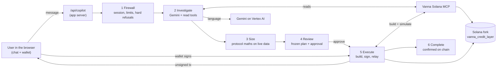

# Vanna Solana Copilot — Architecture

The Copilot is a chat assistant inside the Vanna Solana app (`/copilot`). A user writes what they want in their own
words, such as *"what's my health factor?"*, *"put 100 USDC and 1 SOL into earn"*, *"deposit 100 USDC in margin and
borrow SOL 3x against it"* or *"lever my SOL 2x"*. The Copilot works out what they mean, reads their live position,
answers or prepares the transactions, and their own wallet signs each one.

Editable board: [`solana-copilot-architecture.excalidraw`](solana-copilot-architecture.excalidraw) (open in the
Excalidraw extension, or import at [excalidraw.com](https://excalidraw.com)).

**What it does:** answers about health, positions, collateral, debt, wallet balances, prices, pool rates, earned
interest, Kamino markets and positions, safe borrow / withdraw capacity, what-if scenarios, leverage capacity,
liquidation risk, history, swap quotes and protocol settings; and prepares Earn supply / redeem, margin open / close /
deposit / withdraw / borrow / repay, wallet and margin swaps, Kamino deposit / redeem, leveraged longs, borrows sized to
a leverage target, exact-output swaps, unwinds ("close everything") and chains of up to 8 steps. It refuses
conditional or scheduled orders, liquidating anyone, admin actions, perpetuals / options / shorts, other tokens and
other wallets.

---

## 1. Principles

1. **The model reads and proposes; sealed code owns the money.** Gemini understands the request, investigates the
   account through read tools and proposes an answer or a plan. Code sizes every amount, checks risk and limits,
   freezes the plan, and runs it. The model never produces an amount, never sees a transaction and never signs.
2. **The MCP builds, the wallet signs.** Every transaction is built and simulated by the Vanna Solana MCP and handed
   back unsigned. Only the user's connected wallet (Phantom, Backpack, Solflare) signs. No server holds a key.
3. **Every figure is traceable.** An answer may only contain figures that came from a tool result; a planned amount is
   either a number the user typed or one computed by code from live data.
4. **Nothing is done until the chain confirms it.** A step is complete only when its signature is confirmed.

## 2. System overview



| Piece | Where | Role |
|---|---|---|
| Copilot UI | `components/copilot/*`, `app/copilot/page.tsx` | Chat, answers, clarifications, plan card, approval, step progress, wallet signing |
| Copilot API | `app/api/copilot/route.ts`, `app/api/copilot/auth/*`, `app/api/copilot/workflow/[id]/*` | One chat turn; Sign-In-With-Solana login; plan approve / advance / submit / confirm / cancel |
| Copilot brain | `lib/copilot/*` | The six stages below |
| Gemini | Vertex AI, project `solana-mcp`, model `gemini-3.8-flash`, location `global` | Understands, investigates with tools, decides |
| Vanna Solana MCP | `Vanna_MCP_Solana` repo, Cloud Run `vanna-mcp-solana` | Reads (positions, prices, pools, capacity, history) and unsigned, simulated transaction builds |
| Plan, conversation and limit store | Firestore in `solana-mcp` (an encrypted local file in development) | Plans and their state, pending choices, per-user counters |
| App Solana code | `lib/solana/*` | Price keeper, stale-pool healing, history, the website's own reads |
| Chain | Surfpool mainnet fork `https://rpc-devnet.solana.vanna.finance`; programs `vanna_credit_layer` `H37YVBG3…`, `vanna_oracle` `FXY5DRfe…`, `vanna_validator` `6fND3vht…` | Where everything happens |

## 3. A prompt, end to end

| Stage | Files | What happens |
|---|---|---|
| 1 Firewall | `app/api/copilot/route.ts`, `lib/copilot/auth.ts`, `index.ts` (`handleChat`), `limits.ts`, `domain-firewall.ts` | Session from the signed cookie, per-user chat rate, hard refusals before any model call |
| 2 Investigate | `investigation/runtime.ts`, `prompt.ts`, `catalog.ts`, `decision.ts`, `mcp-facts.ts`, `mcp-client.ts`, `vertex.ts` | Gemini reads the account with tools and ends with one decision; the decision is validated |
| 3 Size | `index.ts` (`handleWrite`), `workflow/leverage-borrow.ts`, `workflow/strategy.ts`, `workflow/unwind.ts`, `workflow/steps.ts` (`resolvePercent`), `risk.ts` | Sizing words become exact amounts from live data with the protocol's maths; account creation and Kamino top-ups are added when needed |
| 4 Review | `workflow.ts` (`createWorkflow`), `plan.ts` (`planDigest`), `workflow/funding.ts`, `components/copilot/plan-approval-card.tsx` | The plan is frozen with exact amounts and a digest, funding and the first step are checked, the card shows steps, warnings and simulation |
| 5 Execute | `app/api/copilot/workflow/[id]/{approve,advance,submit,confirm}`, `workflow.ts`, `workflow/steps.ts` (`preflightStep`, `buildStepTx`), `workflow/swap-heal.ts` | Each step is re-checked against live data, built and simulated by the MCP, signed by the wallet, relayed |
| 6 Complete | `workflow.ts` (`confirmWorkflow`), `workflow/submit-verify.ts`, `components/copilot/plan-run-card.tsx` | Each signature is confirmed on chain; the plan ends completed, paused or failed |

### 3.1 Stage 1: firewall

1. `app/api/copilot/route.ts` receives `{ message, conversation_id, history, clarify }`. The body never carries a
   wallet, an amount to execute or a transaction.
2. `lib/copilot/auth.ts` (`getUser`) reads the signed session cookie created at Sign-In-With-Solana
   (`/api/copilot/auth/nonce` and `/verify`): the wallet signed a login message, so the session's wallet is the user.
3. `index.ts` (`handleChat`) checks the per-user chat rate (`limits.ts`, Firestore counters) and trims the history
   (last 12 turns).
4. `domain-firewall.ts` (`evaluateFirewall`) refuses, before any model call: liquidating someone, admin and protocol
   settings, the faucet, arbitrary programs or transfers to an address, Kamino multi-asset liquidity, perpetuals /
   options / shorts, any other wallet address, tokens outside the product, and abuse or prompt-injection attempts.
   These refusals are final. Whether an ordinary message is on-topic is decided by the model in stage 2.

### 3.2 Stage 2: investigate (Gemini)

`investigation/runtime.ts` runs a bounded loop. Each turn is one Gemini call (`vertex.ts`, thinking level `MEDIUM`,
function calling required) given:

- the instructions in `investigation/prompt.ts`: the product, the protocol maths (§5), the rules for amounts, and the
  stages, all generated from the same constants the guards enforce;
- the conversation, the user's message, the evidence gathered so far and any decision that was rejected;
- the tools: 16 read tools and 6 decision tools.

**Read tools** (`investigation/catalog.ts`, each backed by the MCP through `mcp-facts.ts` / `mcp-client.ts`):

| Tool | Reads |
|---|---|
| `get_account_health` | Health factor, collateral, debt, prices, liquidation status |
| `get_positions` | Margin, Earn and Kamino positions together |
| `get_wallet_balances` | Wallet tokens and Earn shares |
| `get_prices` | Oracle prices the protocol uses |
| `get_pool_rates` | Supply / borrow APR, utilization, liquidity |
| `get_earn_positions` | Redeemable Earn deposits and interest |
| `get_kamino_markets`, `get_kamino_positions` | Kamino lend markets and the user's receipts |
| `get_capacity` | Largest safe borrow / withdrawal at the floor, verified by the program's own check |
| `what_if` | Projected health after a borrow / withdraw / repay, or the amount for a target health |
| `get_leverage_capacity` | Highest safe multiple for a leveraged long and worst-case health at common multiples |
| `get_liquidation_risk` | Liquidation status and distance |
| `get_swap_quote` | Live Jupiter quote and minimum received |
| `get_history`, `get_protocol_info`, `explain_concept` | History, on-chain configuration, product explanations |

The wallet for every read is the session's wallet; a read cannot be pointed elsewhere.

**Decision tools** (`investigation/decision.ts`): `answer` (an answer built from the evidence), `propose_actions` (one
or more actions in order), `propose_leverage` (a leveraged long), `propose_unwind` (exit positions), `ask_user` (one
question when something essential is missing) and `decline` (outside the product).

Each turn Gemini either calls read tools (several at once when they are independent) or one decision tool. Reads run in
parallel with 15 s each; their results become evidence for the next turn. The loop allows 6 turns, 16 reads and 50 s;
the last turn offers only decision tools.

`parseDecision` validates the decision before anything else sees it:

- every op, asset and amount goes through the product guards in `intent.ts` (`validateWrite`, `validateLever`);
- a `literal` amount must be a number the user typed in this or an earlier message (`router.ts` `amountsAreTyped`);
- an `answer`, question or refusal may only contain figures found in a tool result (`vertex.ts` `numbersGrounded`);
- a rejected decision goes back to Gemini with the reason, and the next turn corrects it.

The result is either a structured answer (returned as is) or an intent for stage 3: a single action, a chain, a
leverage strategy, an unwind, a question or a refusal.

### 3.3 Stage 3: size

A decision states amounts as a number the user typed or as a sizing word. Code resolves each one from live data:

| Sizing | Meaning | Resolved by |
|---|---|---|
| `literal` | The user's exact number | Used as typed (after the typed-number check) |
| `fraction` | A percentage of the relevant balance | `workflow/steps.ts` `resolvePercent` |
| `all` | The whole balance or debt | At build time from the live balance |
| `max_safe` | The largest borrow / withdrawal that keeps the floor | `mcp-facts.ts` `sizeSafeBorrow` / `sizeSafeWithdraw` |
| `previous_leg` | The amount the previous action produced | `index.ts` `handleWrite` |
| `leverage` | A borrow sized to an N x target | `workflow/leverage-borrow.ts` `sizeLevBorrow` |
| `receive` | A swap sized so the minimum received covers a typed amount | `workflow/steps.ts` `sizeExactOut` |

Strategies have their own planners: `workflow/strategy.ts` (`planLever`: deposit if needed, borrow a stable, margin
swap into the asset, report) and `workflow/unwind.ts` (`planUnwind`: Kamino, then repay, then withdraw, then Earn).
`handleWrite` also opens a margin account first when the user has none, tops up a Kamino deposit from the wallet when
the margin balance is short, and enforces the 8-step cap.

### 3.4 Stage 4: review

`workflow/funding.ts` checks the wallet can pay for every step and `preflightStep` checks the first step against live
health. `workflow.ts` `createWorkflow` stores the plan with exact amounts, the user's wallet, the health floor and a
sha256 digest over every executable slot (`plan.ts` `planDigest`). The UI shows a single action as a preview card and a
plan as a plan card with its steps, warnings and simulated health. The plan is valid for 5 minutes. A question from the
model is shown as a clarification; the user's reply comes back through the conversation.

### 3.5 Stage 5: execute

1. **Approve** (`/workflow/[id]/approve`): the browser sends the digest it was shown; any change to the plan fails it.
2. **Advance** (`/advance`, `workflow.ts` `advanceWorkflow`): claims the next step exactly once, re-reads what may
   have moved and re-checks health, limits and spend (`preflightStep`); the MCP builds and simulates the transaction
   (`buildStepTx`). A swap that fails on a stale cloned pool is healed with the app's `healStaleDexPools` and rebuilt
   (`workflow/swap-heal.ts`). A step that would breach the 1.15 floor pauses the plan.
3. **Sign**: the wallet signs the unsigned transaction in the browser.
4. **Submit** (`/submit`): the server checks the signed bytes are the transaction it built (`workflow/submit-verify.ts`)
   and relays it.

### 3.6 Stage 6: complete

**Confirm** (`/confirm`, `confirmWorkflow`) waits for the signature on chain and records the step. An unclear outcome is
marked uncertain and never retried automatically; a transaction whose blockhash expired is rebuilt. The plan ends
completed, paused or failed, and the UI shows each step's signature.

### 3.7 Examples

**"How much more could I borrow in USDC?"** Firewall passes. Gemini calls `get_capacity {what: borrow, asset: USDC}`
(and often `get_account_health`), then `answer` with the safe amount and resulting health from that evidence. No plan.

**"Deposit 100 USDC in margin and borrow SOL 3x against that USDC."** Gemini calls `propose_actions` with
`deposit USDC literal 100` and `borrow SOL leverage 3`. `sizeLevBorrow` takes the 100 USDC deposit as the base:
borrow value = (3 − 1) × $100 = $200, SOL amount = $200 ÷ SOL oracle price, rounded down to 9 decimals; it checks
health after the plan stays at or above 1.15. The plan card notes that borrowing SOL and holding it raises leverage
without adding SOL price exposure.

**"Lever my SOL 2x with USDC."** Gemini calls `propose_leverage {asset: SOL, multiple: 2, borrow_asset: USDC}`.
`planLever` borrows (2 − 1) × the SOL equity in USDC, sized so health holds even at the swap's worst price, and plans
borrow, margin swap into SOL, and a health report.

## 4. Gemini in this system

| Setting | Value | Where |
|---|---|---|
| Model | `gemini-3.8-flash` (`VERTEX_MODEL`) | `config.ts` |
| Thinking | `MEDIUM` for the investigation (`COPILOT_THINKING_LEVEL`) | `config.ts`, `vertex.ts` |
| Calling mode | Function calling required: every turn is a read or a decision | `vertex.ts` |
| Budgets | 6 turns (`COPILOT_INVESTIGATION_MAX_TURNS`), 50 s (`COPILOT_INVESTIGATION_TIMEOUT_MS`), 16 reads, 15 s per read | `config.ts`, `investigation/runtime.ts` |
| Output | Up to 4,096 tokens per turn (thinking included) | `investigation/runtime.ts` |
| Daily tokens | Per-user cap (`COPILOT_DAILY_TOKEN_CAP`) | `limits.ts` |
| Switch | `COPILOT_INVESTIGATION=off` uses the keyword router alone | `config.ts` |

Answers of the structured read lane are worded by Gemini from figures code has fixed (`vertex.ts` `wordAnswer`); a
wording with a figure not in the data is discarded.

In development the server log shows every investigation turn (`[copilot:investigate] turn 1: get_wallet_balances(...)`)
and its outcome; with `COPILOT_DEBUG_FACTS=1` and the header `x-copilot-debug: 1` the chat response also carries the
trace and the MCP facts the turn used.

**When Gemini is unreachable** or the investigation ends without a valid decision, the deterministic keyword router
(`router.ts`, `intent.ts`, `conditional.ts`) handles the message with the same guards and lanes, and the product keeps
working for the requests it recognises.

## 5. Protocol maths

The Copilot uses the program's own definitions. Values are USD at the protocol's oracle prices.

| Quantity | Formula | Source |
|---|---|---|
| Position value | token amount × oracle price (debt rounded up, collateral down); no per-asset haircut | `vanna-credit-layer` `programs/vanna_oracle/src/price.rs`, `programs/vanna_credit_layer/src/risk_engine.rs` |
| Health factor | total collateral value ÷ total debt value; none without debt | `programs/vanna_credit_layer/src/math/health.rs` |
| Borrow allowed / liquidation | borrow needs HF > 1.10; liquidatable at HF ≤ 1.10 (whole account) | `constants.rs` `BALANCE_TO_BORROW_THRESHOLD_WAD` |
| Copilot floor | every action that lowers health keeps HF ≥ 1.15 (`MIN_HEALTH_FACTOR`); a user can only raise it | `config.ts`, same as the website's `SAFE_HEALTH_FACTOR` |
| Projected health | (C + deposit + borrow) ÷ (D + borrow); borrowed tokens count as collateral | `lib/margin/amounts.ts` `projectedHealthFactor`, `lib/copilot/risk.ts` `hfAfter` |
| Largest safe borrow | (C − F·D) ÷ (F − 1) | `lib/solana/margin.ts` `maxBorrowUsd`, `lib/copilot/risk.ts` `maxBorrowUsd` |
| Largest safe withdrawal | C − F·D | `lib/copilot/risk.ts` `maxWithdrawUsd` |
| Leverage | collateral ÷ equity, equity = collateral − debt | portfolio view |
| Borrow for N x on a deposit | deposit value × (N − 1) | `lib/margin/amounts.ts` `borrowUsdForLeverage`, `workflow/leverage-borrow.ts` |
| Leveraged long N x | borrow (N − 1) × equity of a stable, swap into the asset; HF checked at the worst allowed price (1% slippage) | `lib/copilot/risk.ts` `sizeLever`, `maxLeverage` |
| Max leverage on a fresh deposit | F ÷ (F − 1) ≈ 7.66x at 1.15 | `lib/solana/margin.ts` `maxLeverage` |
| Token amount from USD | USD ÷ oracle price, rounded down to the token's decimals | `lib/copilot/risk.ts` `usdToUnits`, `lib/margin/amounts.ts` `splitBorrowUsd` |

## 6. What the Copilot may and may not do

- **Assets:** SOL, USDC, USDT (lend, borrow, collateral, swap, farm); JitoSOL and JupSOL (collateral, swap, farm); the
  Kamino receipts farming produces. Other assets registered on-chain are hidden and refused with `asset_not_offered`,
  while any existing position in one still counts in health and can be withdrawn.
- **Refused always:** liquidating someone, admin and protocol settings, the faucet, arbitrary programs, transfers to
  an address, Kamino multi-asset liquidity, perpetuals / options / shorts, other wallets, conditional or scheduled
  orders.
- **Liquidation:** read-only. The Copilot can say whether an account is at risk, never execute a liquidation.
- **Health:** liquidation at 1.10; the Copilot keeps actions at or above 1.15, the same as the website's max buttons.
- **Limits:** $5,000 per action, $25,000 per day, 6 transaction builds per minute, 20 chats per minute, a daily token
  cap, 8 steps per plan.
- **Never:** price predictions, holding keys, signing, or claiming success before confirmation.

## 7. How the Copilot talks to the MCP

- **Transport:** Streamable HTTP. `POST /mcp` with `initialize`, keep the `mcp-session-id`, then `tools/call`. A 404
  means the session was lost on another instance; the client re-initializes and retries.
- **Tools used:** `vanna_protocol_info`, `vanna_oracle`, `vanna_earn_market`, `vanna_earn_position`, `vanna_earn_write`,
  `vanna_account`, `vanna_margin_status`, `vanna_margin_trade`, `vanna_wallet`, `vanna_history`,
  `vanna_farm_overview`, `vanna_farm_kamino`, `vanna_swap`, `vanna_sign` (`tx_status`). The MCP also exposes
  `vanna_plan`, `vanna_risk` and `vanna_portfolio` for other MCP clients. Full list: the MCP's `TOOLS_CATALOGUE.md` §3.
- **Write result (envelope):** `transactions[0].unsignedTransaction` (base64, v0), `requiredSigners`, `blockhash`,
  `lastValidBlockHeight`, `simulation_success`, `code` / `reason` when rejected, `summary`. Amounts are decimal strings.
- **Errors:** `{"error": "<code>", "message": "..."}`, e.g. `invalid_input`, `asset_not_offered`, `price_unavailable`,
  `insufficient_scope`, `rate_limited` (HTTP 429 with `Retry-After`).
- **Auth (hosted):** the Copilot holds a WorkOS machine-to-machine credential (`client_credentials`), caches the token
  and sends it as `Authorization: Bearer`; its client id is in the MCP's `FIRST_PARTY_CLIENT_IDS`. Cloud Run also
  requires IAM: the Copilot sends a Google ID token for the MCP's URL in `X-Serverless-Authorization`, and only the
  app's runtime service account may invoke. Users never hold a WorkOS token; they sign in with their wallet. Locally
  the MCP runs without auth.
- **Limits:** all Copilot traffic reaches the MCP as one client, so the Copilot limits each user itself and backs off
  on 429.

## 8. Testing

| Suite | Command | Covers |
|---|---|---|
| Unit and flow tests | `npx vitest run` | Firewall, router, guards, risk maths, investigation loop with a scripted model (`lib/copilot/tests/investigation.test.ts`), plans, workflow, limits, auth |
| Type check | `npx tsc --noEmit` | Whole app |
| Live prompt suite | `npx tsx scripts/copilot-prompt-suite.ts` (`--only <category>`, `--no-exec`) | The running stack over HTTP with real Gemini, the local MCP and fork wallets: about 390 prompts and 15 API attacks, including executed round trips. Reports go to `scripts/copilot-prompts/reports/` |

Local stack for the live suite: the MCP (`python scripts/run_local.py` in `Vanna_MCP_Solana`, port 8000), the app
(`npm run dev` with `.env.local`: `MCP_BASE_URL=http://localhost:8000/mcp`, `MCP_AUTH_MODE=none`,
`COPILOT_DEBUG_FACTS=1`), and Vertex credentials (`gcloud auth application-default login`, quota project
`solana-mcp`).

## 9. Comparison with the Stellar Copilot

| | Stellar Copilot | Solana Copilot |
|---|---|---|
| Where it runs | Inside the website's server | Inside `vanna-credit-backend`'s server |
| Stages | Firewall, investigate, size, review, execute, complete | Same |
| AI | Gemini investigates with read tools and plans | Same (§3.2, §4) |
| Tools | Vanna MCP | Vanna Solana MCP |
| Plans | Stored server-side, approved by digest, run step by step | Same |
| Who signs | Wallet, or a server-side Sign Service with auto-sign | Wallet only; no Sign Service, no auto-sign |
| Login | Privy, WorkOS, or a Freighter wallet proof | Sign-In-With-Solana |
| DeFi integrations | Blend, Aquarius, Soroswap | Kamino lend, Jupiter swaps |
| Prices on the test network | Live oracle | The app's price keeper refreshes the fork's oracle feeds |

## 10. Decisions in force

| Topic | Decision |
|---|---|
| Network | Hosted Surfpool mainnet fork `https://rpc-devnet.solana.vanna.finance`; `vanna_credit_layer` `H37YVBG3eGtz89ofd7iDLc2PJgn12778392XeU2QJcGC` with its oracle and validator agents (vanna-credit-layer `465f21a`) |
| Understanding | Gemini investigates and decides; code owns amounts, risk, limits, approval and execution |
| Who builds transactions | The MCP (unsigned, simulated) |
| Who signs | The user's wallet; no Sign Service, no auto-sign |
| Prices on the fork | The app's price keeper |
| Lend / borrow | SOL, USDC, USDT |
| Product assets | SOL, USDC, USDT, JitoSOL, JupSOL and Kamino receipts |
| Liquidation, admin, faucet, perps | Not offered by the Copilot |
| AI | Vertex Gemini `gemini-3.8-flash` in `solana-mcp`; service account `vanna-copilot` (`roles/aiplatform.user`); no service-account keys (organization policy), so hosted uses the attached account and local uses a developer's login |
| Copilot → MCP auth | WorkOS machine-to-machine token plus Cloud Run IAM (§7); the M2M secret lives only in Secret Manager |
| Limits | Per-user limits in the Copilot |
| Mainnet | Not in scope; everything targets the fork |

## 11. Hosting

The two GCP projects' default VPCs both use `10.128.0.0/20` in `us-central1`, so custom networks are used. The app has
Direct VPC egress (`all-traffic`) with Cloud NAT `vanna-internal-nat` (router `vanna-internal-router`) on its subnet,
so Jupiter and the fork RPC stay reachable. The NAT must exist before the egress is attached; otherwise `/api/prices`
returns 502 until the NAT propagates.

### App — `vanna-credit-solana-test`

| Item | Value |
|---|---|
| Cloud Run service | `vanna-credit-solana-test` in `us-central1` |
| Public origin | `https://test.solana.vanna.finance` (`NEXT_PUBLIC_SITE_URL`) |
| Run URL | `https://vanna-credit-solana-test-o3dmfat4aq-uc.a.run.app` |
| Runtime SA | `vanna-credit-runtime@vanna-credit-solana-test.iam.gserviceaccount.com` |
| Builder SA | `vanna-credit-builder@vanna-credit-solana-test.iam.gserviceaccount.com` |
| Current image | `us-central1-docker.pkg.dev/vanna-credit-solana-test/vanna-credit/app:e4c5971`, revision `vanna-credit-solana-test-00016-6fs`. Revision `00005-dt6` (app without the Copilot) is the rollback target |
| Secrets | Secret Manager: `workos-m2m-client-secret`, `copilot-session-secret`, `copilot-store-secret`, readable by the runtime SA, mounted as env |
| NAT | `vanna-internal-nat` on router `vanna-internal-router` (subnet `vanna-internal-usc1`) |
| Custom VPC | `vanna-internal` / subnet `vanna-internal-usc1` `10.50.0.0/24` (Private Google Access on) |
| Peering | `app-to-solana-mcp` → `solana-mcp/vanna-internal` (active, not on the MCP call path: calls go over the `run.app` URL) |

### MCP and Copilot data — `solana-mcp`

| Item | Value |
|---|---|
| Firestore | Native `(default)` in `us-central1` |
| Vertex | `gemini-3.8-flash`, location `global`; SA `vanna-copilot@solana-mcp.iam.gserviceaccount.com` |
| Cloud Run | `vanna-mcp-solana`, image `mcp-solana:c751774`, revision `00005-jhg`, `PROTOCOL_LOOKUP_TABLES=Df9ZBRDkqd2ReYWP4HjRdn4V9u9PiQp1AgyWGVEH7H66`, `--ingress=all` with IAM required (no `allUsers` invoker; anonymous calls get 403), `AUTH_ENABLED=true`, `TRUSTED_PROXY_HOPS=1`, Direct VPC `vanna-internal` with `private-ranges-only` egress. URL `https://vanna-mcp-solana-398807408840.us-central1.run.app`. Internal ingress is not used because it rejects callers from another project |
| Builder SA | `vanna-mcp-builder@solana-mcp.iam.gserviceaccount.com`: `storage.objectViewer`, `artifactregistry.writer`, `logging.logWriter`. Build with a build-only config (`logging: CLOUD_LOGGING_ONLY`) |
| Artifact Registry | `us-central1-docker.pkg.dev/solana-mcp/vanna-credit` |
| Custom VPC | `vanna-internal` / subnet `vanna-internal-usc1` `10.40.0.0/24` (Private Google Access on) |
| Peering | `solana-mcp-to-app` → `vanna-credit-solana-test/vanna-internal` (active, not on the MCP call path) |

Cross-project IAM on `solana-mcp` for the app runtime SA: `roles/datastore.user`, `roles/aiplatform.user`,
`roles/serviceusage.serviceUsageConsumer`, and `roles/run.invoker` on `vanna-mcp-solana`.

### Copilot env on the app (no secrets in git)

```
MCP_BASE_URL=https://vanna-mcp-solana-398807408840.us-central1.run.app/mcp
MCP_IAM_AUDIENCE=https://vanna-mcp-solana-398807408840.us-central1.run.app
MCP_AUTH_MODE=workos
WORKOS_M2M_CLIENT_ID=client_01M3XFWY6BCVAN1XPS0RZW6Y0F
WORKOS_M2M_TOKEN_URL=https://sensitive-silk-47-staging.authkit.app/oauth2/token
GOOGLE_CLOUD_PROJECT=solana-mcp
GOOGLE_CLOUD_LOCATION=global
VERTEX_MODEL=gemini-3.8-flash
COPILOT_FIRESTORE_PROJECT=solana-mcp
COPILOT_FIRESTORE_DATABASE=(default)
COPILOT_FIRESTORE_COLLECTION_PREFIX=solana_copilot_
COPILOT_PUBLIC_ORIGIN=https://test.solana.vanna.finance
COPILOT_AUTH_DOMAIN=test.solana.vanna.finance
```

Optional: `COPILOT_THINKING_LEVEL`, `COPILOT_INVESTIGATION_MAX_TURNS`, `COPILOT_INVESTIGATION_TIMEOUT_MS`,
`COPILOT_INVESTIGATION` (§4).

### WorkOS (staging)

An M2M application "Vanna Solana Copilot" (`connect_app_01M3XFWY6CP3PD4FTNY8V1JNXX`) in the staging environment,
organization `Test Organization`, created through the WorkOS Connect API (`POST /connect/applications`,
`application_type: m2m`); the dashboard's create dialog does not offer M2M. The MCP is configured with:

```
OAUTH_ISSUER=https://sensitive-silk-47-staging.authkit.app
OAUTH_JWKS_URI=https://sensitive-silk-47-staging.authkit.app/oauth2/jwks
OAUTH_AUDIENCE=client_01KX5H81JH2HWD2DHKYFYFXNS2     # the token's `aud` is the environment client id
FIRST_PARTY_CLIENT_IDS=client_01M3XFWY6BCVAN1XPS0RZW6Y0F
```

The client secret exists only in Secret Manager. A production launch repeats this in the production WorkOS
environment.

### URLs and deploys

- `test.solana.vanna.finance` is a custom-domain mapping to the same Cloud Run service as the `…run.app` URL.
- The app is deployed by hand: build an image from `main`, then `gcloud run deploy`. Nothing in GitHub triggers a
  deploy, so the site shows whatever was deployed last.
- **Build:** a build-only config (`logging: CLOUD_LOGGING_ONLY`, builder SA), then
  `gcloud run deploy vanna-credit-solana-test --image …:<tag>` without env, secret or network flags, so the Copilot
  configuration on the service is kept.
- **Test locally before deploying:** run the local stack (§8), test, then deploy once.
- **MCP smoke test:** the MCP cannot be called anonymously. Check the `solana-mcp` request logs for the app's calls,
  or sign in at `/copilot` and ask for a price.

### Fork behaviours handled in `lib/copilot`

- **Stale DEX pools on swaps.** Cloned concentrated-liquidity pool state drifts, so a swap that quoted fine can fail
  simulation (Anchor 3005, Jupiter 6001, Whirlpool 6023). The Copilot re-clones the pools the failed build touched
  with the app's `healStaleDexPools` and asks the MCP to build again, up to 2 times.
- **Stale-flagged oracle price.** The Copilot refreshes once through the app's price keeper (throttled 15 s) and lets
  the build decide; the MCP refreshes, simulates and fails closed on a genuinely stale price. An unavailable price is
  refused.
- **Transaction size.** Margin swaps load protocol-wide accounts from the frozen protocol lookup table named by the
  MCP's `PROTOCOL_LOOKUP_TABLES` and cap Jupiter's route size so they fit Solana's 1232-byte limit. A fork reset deletes
  the table; recreate it with the MCP's `scripts/create_protocol_lookup_table.py`.
- **Slow fork RPC reads** get a 30 s timeout, with a body-read timeout retried once.
- **First call on a new instance** can fail while VPC egress and NAT come up; the WorkOS token request is retried up
  to 3 times.
- Raw runtime errors (`InstructionError … Custom(3005)`) are shown as plain sentences, and Kamino receipts are named
  with their underlying worth.

### Open

1. Rotate the WorkOS `sk_test` API key (and the M2M secret if wanted); both were held in plain files during setup.
2. Production: repeat WorkOS and hosting in the production environment; decide whether to tighten the MCP (VPC
   Service Controls or hosting it in the app's project) instead of `ingress=all`.
3. Deploys from `main` by a trigger or a single agreed procedure, so the live site always matches `main`.
