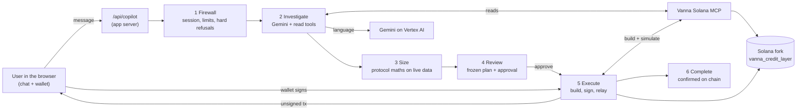

# Vanna Solana Copilot — Architecture

The Copilot is a chat assistant inside the Vanna Solana app (`/copilot`). A user writes what they want in their own
words, such as *"what's my health factor?"*, *"put 100 USDC and 1 SOL into earn"*, *"deposit 100 USDC in margin and
borrow SOL 3x against it"* or *"lever my SOL 2x"*. The Copilot works out what they mean, reads their live position,
answers or prepares the transactions, and their own wallet signs each one.

Editable board: [`solana-copilot-architecture.excalidraw`](solana-copilot-architecture.excalidraw) (open in the
Excalidraw extension, or import at [excalidraw.com](https://excalidraw.com)).

**What it does:** answers about health, positions, collateral, debt, wallet balances, prices, pool rates, earned
interest, Kamino markets and positions, safe borrow / withdraw capacity, what-if scenarios, leverage capacity,
liquidation risk, history, swap quotes and protocol settings; and prepares Earn supply / redeem, margin open / close /
deposit / withdraw / borrow / repay, wallet and margin swaps, Kamino deposit / redeem, leveraged longs, borrows sized to
a leverage target, exact-output swaps, unwinds ("close everything") and chains of up to 8 steps. It refuses
conditional or scheduled orders (the rest of the request still goes ahead), liquidating anyone, admin actions,
perpetuals / options / shorts, other tokens and other wallets.

---

## 1. Principles

1. **The model reads and proposes; sealed code owns the money.** Gemini understands the request, investigates the
   account through read tools and proposes an answer or a plan. Code sizes every amount, checks risk and limits,
   freezes the plan, and runs it. The model never produces an amount, never sees a transaction and never signs.
2. **The MCP builds, the wallet signs.** Every transaction is built and simulated by the Vanna Solana MCP and handed
   back unsigned. Only the user's connected wallet (Phantom, Backpack, Solflare) signs. No server holds a key.
3. **Every figure is traceable.** An answer may only contain figures that came from a tool result; a planned amount is
   either a number the user typed or one computed by code from live data.
4. **Nothing is done until the chain confirms it.** A step is complete only when its signature is confirmed.

## 2. System overview



| Piece | Where | Role |
|---|---|---|
| Copilot UI | `components/copilot/*`, `app/copilot/page.tsx` | Chat, answers, clarifications, plan card, approval, step progress, wallet signing. The left panel has two lists. **Margin Positions** shows the margin account: **Collateral** is what the user deposited or swapped into (the margin vault balance minus the debt of that asset, Kamino receipts included) and **Borrowed** is the debt, so a borrow changes only Borrowed and a deposit only Collateral. **Earn Positions** shows Earn pool deposits (the amount redeemable now, from the same lender positions the Earn page reads). Rows that would read 0 are hidden |
| Copilot API | `app/api/copilot/route.ts`, `app/api/copilot/auth/*`, `app/api/copilot/workflow/[id]/*` | One chat turn; Sign-In-With-Solana login; plan approve / advance / submit / confirm / cancel |
| Copilot brain | `lib/copilot/*` | The six stages below |
| Gemini | Vertex AI, project `solana-mcp`, model `gemini-3.8-flash`, location `global` | Understands, investigates with tools, decides |
| Vanna Solana MCP | `Vanna_MCP_Solana` repo, Cloud Run `vanna-mcp-solana` | Reads (positions, prices, pools, capacity, history) and unsigned, simulated transaction builds |
| Plan, conversation and limit store | Firestore in `solana-mcp` (an encrypted local file in development) | Plans and their state, pending choices, per-user counters |
| App Solana code | `lib/solana/*` | Price keeper, stale-pool healing, history, the website's own reads |
| Chain | Surfpool mainnet fork `https://rpc-devnet.solana.vanna.finance`; programs `vanna_credit_layer` `H37YVBG3…`, `vanna_oracle` `FXY5DRfe…`, `vanna_validator` `6fND3vht…` | Where everything happens |

## 3. A prompt, end to end

| Stage | Files | What happens |
|---|---|---|
| 1 Firewall | `app/api/copilot/route.ts`, `lib/copilot/auth.ts`, `index.ts` (`handleChat`), `limits.ts`, `domain-firewall.ts` | Session from the signed cookie, per-user chat rate, hard refusals before any model call |
| 2 Investigate | `investigation/runtime.ts`, `prompt.ts`, `catalog.ts`, `decision.ts`, `mcp-facts.ts`, `mcp-client.ts`, `vertex.ts` | Gemini reads the account with tools and ends with one decision; the decision is validated |
| 3 Size | `index.ts` (`handleWrite`), `workflow/leverage-borrow.ts`, `workflow/strategy.ts`, `workflow/unwind.ts`, `workflow/steps.ts` (`resolvePercent`), `risk.ts` | Sizing words become exact amounts from live data with the protocol's maths; account creation and Kamino top-ups are added when needed |
| 4 Review | `workflow.ts` (`createWorkflow`), `plan.ts` (`planDigest`), `workflow/funding.ts`, `components/copilot/plan-approval-card.tsx` | The plan is frozen with exact amounts and a digest, funding and the first step are checked, the card shows steps, warnings and simulation |
| 5 Execute | `app/api/copilot/workflow/[id]/{approve,advance,submit,confirm}`, `workflow.ts`, `workflow/steps.ts` (`preflightStep`, `buildStepTx`), `workflow/swap-heal.ts` | Each step is re-checked against live data, built and simulated by the MCP, signed by the wallet, relayed |
| 6 Complete | `workflow.ts` (`confirmWorkflow`), `workflow/submit-verify.ts`, `components/copilot/plan-run-card.tsx` | Each signature is confirmed on chain; the plan ends completed, paused or failed |

### 3.1 Stage 1: firewall

1. `app/api/copilot/route.ts` receives `{ message, conversation_id, history, clarify }`. The body never carries a
   wallet, an amount to execute or a transaction.
2. `lib/copilot/auth.ts` (`getUser`) reads the signed session cookie created at Sign-In-With-Solana
   (`/api/copilot/auth/nonce` and `/verify`): the wallet signed a login message, so the session's wallet is the user. Signing out (`/api/copilot/auth/logout`)
   also records a per-wallet cut-off in the store, so every earlier session for that wallet stops working, not just
   this browser's cookie.
3. `index.ts` (`handleChat`) checks the per-user chat rate (`limits.ts`, Firestore counters) and trims the history
   (last 12 turns).
4. `domain-firewall.ts` (`evaluateFirewall`) refuses, before any model call: liquidating someone, admin and protocol
   settings, the faucet, arbitrary programs or transfers to an address, any other wallet address, tokens outside the
   product, and abuse or prompt-injection attempts. These refusals are final. Whether an ordinary message is on-topic,
   which parts are conditional, scheduled or recurring orders, and which ask for something the product does not offer
   (perpetuals / options / shorts, Kamino multi-asset liquidity) is read by the model in stage 2 (see "Timing and
   parts that are not done"). Only when the model is unavailable are conditional orders and those products refused
   whole here, in the product's words (`router.ts` `conditionalRefusal`, `domain-firewall.ts` `productRefusal`).

   The rule decides a refusal; Gemini only words it. `decline.ts` (`composeDecline`) gets the rule, the rule's own
   wording and the product's facts, and writes a short reply for this message in the user's tone and language: what
   isn't possible, why, and the closest thing that is. It has no tools. Its reply is shown only if it passes the checks
   (no number that isn't in the facts, no address, link, code or claim that something was done); otherwise, or when
   the model is off or fails, the rule's own wording is shown. Router and guard refusals and "I'm not sure what you
   mean" go through the same path.

   Every other failure is worded the same way. `index.ts` `handleChat` sends any `blocked`, `clarification`,
   `unavailable` or `error` reply that code produced (a sizing question, a pre-check refusal, an unreadable balance, a
   build the app refused) through `decline.ts` `composeFailure`, with the code's message as FACTS: the code decides what
   happened and what is needed, and Gemini writes what the user reads, checked the same way. Two kinds are not worded:
   replies Gemini already wrote (its own question or decline), and rate / token-budget limits, since wording them would
   spend the budget that ran out. While a plan runs, a pause, a rejected send and an on-chain failure are worded too
   (`workflowDeps.word`); whether a pause is retried automatically is the server's flag (`pause_transient`), never read
   from the wording.

### 3.2 Stage 2: investigate (Gemini)

`investigation/runtime.ts` runs a bounded loop. Each turn is one Gemini call (`vertex.ts`, thinking level `MEDIUM` on the
first turn and after a rejected decision, `LOW` on turns that turn gathered evidence into a decision;
function calling required) given:

- the instructions in `investigation/prompt.ts`: the product, the protocol maths (§5), the rules for amounts, and the
  stages, all generated from the same constants the guards enforce;
- the conversation, the user's message, the evidence gathered so far and any decision that was rejected;
- the tools: 18 read tools, `calculate`, and 6 decision tools.

**Read tools** (`investigation/catalog.ts`, each backed by the MCP through `mcp-facts.ts` / `mcp-client.ts`):

| Tool | Reads |
|---|---|
| `get_account_health` | Health factor, collateral, debt, prices, liquidation status |
| `get_positions` | Margin, Earn and Kamino positions together |
| `get_wallet_balances` | Wallet tokens and Earn shares |
| `get_prices` | Oracle prices the protocol uses |
| `get_pool_rates` | Supply / borrow APR, utilization, liquidity |
| `get_earn_positions` | Earn deposits: shares and the amount redeemable now (fast) |
| `get_earn_interest` | Interest earned, reconstructed from on-chain history (slow; only when asked about earnings) |
| `get_kamino_markets`, `get_kamino_positions` | Kamino lend markets and the user's receipts |
| `get_capacity` | Largest safe borrow / withdrawal at the floor, verified by the program's own check |
| `what_if` | Projected health after a borrow / withdraw / repay, or the amount for a target health |
| `get_leverage_capacity` | Highest safe multiple for a leveraged long and worst-case health at common multiples |
| `get_liquidation_risk` | Liquidation status and distance |
| `simulate` | Any scenario on the protocol's health maths: price moves on any assets ("SOL drops 10%") and hypothetical deposits, withdrawals, borrows, repays, swaps and farms, in order. Returns collateral, debt and HF now, after the changes and after the price moves, whether it would be liquidatable or below the floor, and how far each moved asset could fall (or rise) before liquidation (`investigation/simulate.ts`; swaps at oracle prices before slippage) |
| `get_swap_quote` | Live Jupiter quote and minimum received |
| `get_history`, `get_protocol_info`, `explain_concept` | History, on-chain configuration, product explanations |

The wallet for every read is the session's wallet; a read cannot be pointed elsewhere.

**Decision tools** (`investigation/decision.ts`): `answer` (an answer built from the evidence), `propose_actions` (one
or more actions in order, with report legs), `propose_leverage` (a leveraged long), `propose_unwind` (exit positions),
`ask_user` (one question when something essential is missing) and `decline` (outside the product).

**Timing and parts that are not done.** Gemini reads the whole message, in any wording or language, and
`propose_actions` says how it read it:

- `not_done`: each part that will not be done, as the user's own words (`part`, checked with `quotesUser`), a reason
  (grounded, no internal names) and a `kind`: `waits_for_condition_or_time` (a conditional, scheduled, recurring or
  standing order: the product only acts now), `not_offered` (a short, a multi-asset LP, ...) or `other`. They lead the
  plan's notes ("Not done: ..."); the rest of the plan goes ahead. A message that is only such an order is declined.
- `requested_count`: how many transactions the user asked for, repeats included.
- `no_condition`: set only when nothing in the message is a condition, although some words may look like one.

Code keeps the model consistent, without word lists of its own:

- an action whose quoted words come from a part listed in `not_done` is rejected (a part is done now or not at all), so
  "sell 1 SOL when it hits 200" held back can never become "sell 1 SOL" now;
- the server's conditional-wording check (`conditional.ts` `detectConditional`) is a cross-check: when it flags the
  message, the decision must explain the timing (a `waits_for_condition_or_time` part, a `health_target` sizing, a
  `simulate` report for a what-if) or set `no_condition`; otherwise it goes back to Gemini with the reason. The same
  applies to `propose_leverage` and `propose_unwind`;
- fewer transactions than `requested_count` with no `not_done` for the rest goes back to Gemini; when the 8-step cap
  is what left them out, code adds the note ("A plan holds at most 8 transactions, so the last one is not in this
  plan; ask for it after this plan completes").

So "borrow USDC until my health factor is 1.5" is planned now (health_target), "what happens if SOL drops 10%" is a
simulate, "sell 1 SOL when it hits 200 and supply 100 USDC" plans the supply and reports the sale as not done, and
"when SOL drops below 100, sell 1 SOL" is declined. Gemini is told to check its tools before calling anything
impossible (`simulate`, `calculate`, the reads) and to decline only when nothing in the request can be done.

**Report legs** (things to see inside a plan). A request can ask to see something before, between or after its
transactions ("deposit 100 USDC, 100 USDT and 1 SOL into the lending pool, then show my total supplied balance and APY";
"show my health factor, borrow 50 USDC, then show it again"). Gemini keeps each such part as an `op: "report"` leg of
`propose_actions`, at the point the user asked for it, with the read tools that answer it (any catalogue tool, with its
arguments as `args_json`), a short label and the user's quoted words. Nothing about which reads to run is fixed in code.
`parseDecision` checks the quote, that each tool exists and its arguments are usable (`catalog.ts` `readArgsProblem`),
at most 4 reads per leg and 6 legs per plan, and that a plan holds at least one transaction (a request that only asks to
see things is answered now). The leg becomes a read step of the plan (`plan.ts` `readLegStep`; its reads are hashed
with the plan). When the plan reaches it, after every earlier transaction confirmed, `investigation/plan-reads.ts`
runs its reads live and Gemini writes the answer with the `answer` tool from those results alone, under the same
grounding check (a figure not in a result is refused, then retried once); if the model is unavailable the readers' own
wording is shown. The answer is stored on the step and shown on the plan card at that step, as soon as it runs.

Each turn Gemini either calls read tools (several at once when they are independent) or one decision tool. Reads run in
parallel with 15 s each; their results become evidence for the next turn. The loop allows 6 turns, 16 reads and 50 s;
the last turn offers only decision tools.

`parseDecision` validates the decision before anything else sees it:

- every op, asset and amount goes through the product guards in `intent.ts` (`validateWrite`, `validateLever`);
- every proposed action quotes the user's own words asking for it (`source_quote`, at least 80% of its words found in the
  user's messages, `quotesUser`); an action that cannot be quoted was not asked for, so an invented step (a swap, a deposit
  nobody mentioned) is rejected and the model is told to leave it out;
- a `literal`, `usd` or `receive` amount, a `health_target`, and the base amount of a leverage borrow must be a number
  the user gave in this or an earlier message: typed in digits (`router.ts` `amountsAreTyped`), or written in words in
  any language, which Gemini reads and copies into `as_written`; the copy must appear in the user's message;
- an `answer`, question or refusal may only contain figures found in a tool result (`vertex.ts` `numbersGrounded`).
  Gemini never computes a figure itself: for a total, a difference, a USD value or a percentage no tool reports, it
  calls `calculate` (`investigation/calculate.ts`) with figures copied from the evidence; the code checks every operand
  is in the evidence, does the exact arithmetic, and the result becomes evidence the answer may quote;
- a rejected decision goes back to Gemini with the reason, and the next turn corrects it.

The result is either a structured answer (returned as is) or an intent for stage 3: a single action, a chain, a
leverage strategy, an unwind, a question or a refusal.

### 3.3 Stage 3: size

A decision states amounts as a number the user typed or as a sizing word. Code resolves each one from live data:

| Sizing | Meaning | Resolved by |
|---|---|---|
| `literal` | The user's exact number of tokens (digits or words) | Used as typed (after the typed-number check) |
| `usd` | A dollar value the user typed ("$50 worth of SOL") | `index.ts` `handleWrite`: units = USD ÷ oracle price, rounded down to the token's decimals, when the plan is drawn |
| `fraction` | A percentage of the relevant balance | `workflow/steps.ts` `resolvePercent` |
| `all` | The whole balance or debt | At build time from the live balance |
| `max_safe` | The largest borrow / withdrawal that keeps the floor. A borrow never exceeds the pool's available liquidity. With `base_asset` + `base_amount` ("what I can borrow against 5 JupSOL"), a borrow is sized on that holding alone: x with (V + x) / x = floor, capped by the whole account, the pool and the per-action limit | `mcp-facts.ts` `sizeSafeBorrow` / `sizeSafeWithdraw`; `workflow/leverage-borrow.ts` `sizeBorrowAgainst` |
| `health_target` | Sized so the health factor ends at a number the user gave ("borrow until my health factor is 1.5", "repay enough to get back to 2"). Carried as `hf:<target>` and sized when the step is built, after every earlier step: borrow / withdraw use the safe sizers with the target as the floor (never below 1.15); repay from the wallet x = D − C/T, from the margin balance x = (T·D − C)/(T − 1); deposit x = T·D − C; repay and deposit round up, a repay never exceeds the debt; already at the target = the step is skipped | `mcp-facts.ts` `sizeToHealth`, `workflow/steps.ts` `preflightStep` |
| `previous_leg` | The amount the previous action produced, or a percentage of it ("swap half of it") | `index.ts` `handleWrite` |
| `leverage` | A borrow at N x leverage, as on the website's Margin page: borrow value = base value × (N − 1), nothing swapped. The base is the collateral the user names (`base_asset`, `base_amount`, which they must hold or deposit in the same plan), else the deposits in the request, else the account's equity | `workflow/leverage-borrow.ts` `sizeLevBorrow` |
| `receive` | A swap sized so the minimum received covers a typed amount | `workflow/steps.ts` `sizeExactOut` |

Strategies have their own planners: `workflow/strategy.ts` (`planLever`: deposit if needed, borrow a lendable asset the
user names or picks (any registry `lendable` token other than the one levered), margin swap into the asset, report) and `workflow/unwind.ts` (`planUnwind`: Kamino, then repay, then withdraw, then Earn).
`handleWrite` also opens a margin account first when the user has none, tops up a Kamino deposit or a vault deposit from
the wallet when the margin balance is short, and enforces the 8-step cap. Every vault deposit spends margin USDC, SOL
Basis included (website `82c5a05`): the MCP builds it as one transaction routed through the wallet (margin USDC out, vault
deposit, vbSOL back into margin), and the preview reports the health factor while that USDC is out of the margin account
(`health_factor_while_usdc_moves`, which the program checks; a refusal at 1.10 or below comes back in the website's
wording). `vault_move_shares` is now only a recovery step for vbSOL left in the wallet. Until a Basis vault has a 7-day figure,
its yield shows Phoenix funding plus the raw share-price return since launch (`return_since_launch_pct` over
`since_launch_days`), never annualised, as the website shows it (backend `aaed5cc`).

#### Predict (World.xyz prediction markets, website `1a9cb3c`)

Everything the website's Predict page does, through the MCP's `vanna_predict` (which calls the app's `/api/predict/*`;
the app builds each trade and its market maker co-signs it). Wallet-only: CASH from the wallet, no margin account, no
borrowing, no health factor.

- **Reads** (`investigation/catalog.ts`, answers in `predict-facts.ts`): `get_predict_markets` (category / search),
  `get_predict_market`, `get_predict_positions`, `get_predict_history`, `get_predict_quote`. The market reads reach
  the model as compact rows (`[market_id, name, yes buy/sell, no buy/sell, tradable, joins pool]`, prices in cents) with a
  larger observation budget, so no market id is cut off. The left panel lists Predict positions (the website's
  `usePredictPositions`).
- **Writes**: the model names `predict_buy` (CASH: literal 0.1-5,000, usd = CASH at $1, all / fraction of the wallet's
  CASH), `predict_sell` (shares; all / fraction of wallet + pooled shares) and `predict_deposit` (World shares in the
  wallet into Vanna's pool), each with a `market_id` that must appear in a Predict read in the evidence (decision.ts
  refuses one it did not read) and `outcome` yes / no. `handleWrite` reads each market (name, YES / NO labels, live
  price: an untradable outcome is refused), sizes all / fractions from the positions read, and merges the outcomes of
  one request into ONE `predict_trade` step (max 8; one approval). `predict_faucet` (test CASH, up to 1,000) runs at
  once, since it is a cheatcode, not a transaction. As on the website: CASH only (no USDC payment) and a buy on an
  allowlisted market always joins the pool. The fallback router has no Predict ops (it reads nothing, so it has no ids).
- **Checks** (`workflow/steps.ts` `preflightPredict`): the wallet's CASH covers the buys, the shares are held for a sell or
  deposit, the spend caps (CASH at $1), and the app's live quote for the card.
- **Signing**: the envelope carries every transaction (`UnsignedTx.batch`). The browser signs them with ONE
  `signAllTransactions`; `submitWorkflow` verifies each against what was built (the maker's signature included), marks the
  step submitted, then sends them in order, each confirmed before the next. A failure after the first one stops there and
  is never rebuilt (that would trade again). After the last confirms, the app's keeper merges the touched pools
  (`predictMerge`), noted on the step.

### 3.4 Stage 4: review

`workflow/funding.ts` checks the wallet can pay for every step and `preflightStep` checks the first step against live
health. `workflow.ts` `createWorkflow` stores the plan with exact amounts, the user's wallet, the health floor and a
sha256 digest over every executable slot (`plan.ts` `planDigest`). The UI shows a single action as a preview card and a
plan as a plan card with its steps, warnings and simulated health. The plan is valid for 5 minutes. A question from the
model is shown as a clarification; the user's reply comes back through the conversation.

### 3.5 Stage 5: execute

1. **Approve** (`/workflow/[id]/approve`): the browser sends the digest it was shown; any change to the plan fails it.
2. **Advance** (`/advance`, `workflow.ts` `advanceWorkflow`): claims the next step exactly once, re-reads what may
   have moved and re-checks health, limits and spend (`preflightStep`); the MCP builds and simulates the transaction
   (`buildStepTx`). A swap that fails on a stale cloned pool is healed with the app's `healStaleDexPools` and rebuilt
   (`workflow/swap-heal.ts`). A step that would breach the 1.15 floor pauses the plan.
3. **Sign**: the wallet signs the unsigned transaction in the browser.
4. **Submit** (`/submit`): the server checks the signed bytes are the transaction it built (`workflow/submit-verify.ts`)
   and relays it.

### 3.6 Stage 6: complete

**Confirm** (`/confirm`, `confirmWorkflow`) waits for the signature on chain and records the step. An unclear outcome is
marked uncertain and never retried automatically; a transaction whose blockhash expired is rebuilt. The plan ends
completed, paused or failed, and the UI shows each step's signature.

### 3.7 Examples

**"How much more could I borrow in USDC?"** Firewall passes. Gemini calls `get_capacity {what: borrow, asset: USDC}`
(and often `get_account_health`), then `answer` with the safe amount and resulting health from that evidence. No plan.

**"Deposit 100 USDC in margin and borrow SOL 3x against that USDC."** Gemini calls `propose_actions` with
`deposit USDC literal 100` and `borrow SOL leverage 3`. `sizeLevBorrow` takes the 100 USDC deposit as the base:
borrow value = (3 − 1) × $100 = $200, SOL amount = $200 ÷ SOL oracle price, rounded down to 9 decimals; it checks
health after the plan stays at or above 1.15. The plan card notes that borrowing SOL and holding it raises leverage
without adding SOL price exposure.

**"Take a loan of USDC using 0.5 SOL with 2x leverage, use my existing SOL collateral."** Gemini calls `propose_actions`
with one action, `borrow USDC leverage 2, base SOL 0.5`, quoting the user's words. `sizeLevBorrow` checks the margin
account holds 0.5 SOL, then borrows 0.5 SOL × price × (2 − 1) of USDC. Nothing is swapped: a loan at a leverage multiple is a
borrow.

**"Go long SOL 2x with USDC" / "lever my SOL 2x".** The user wants more exposure to SOL, so Gemini calls
`propose_leverage {asset: SOL, multiple: 2, borrow_asset: USDC}`.
`planLever` borrows (2 − 1) × the SOL equity in USDC, sized so health holds even at the swap's worst price, and plans
borrow, margin swap into SOL, and a health report.

## 4. Gemini in this system

| Setting | Value | Where |
|---|---|---|
| Model | `gemini-3.8-flash` (`VERTEX_MODEL`) | `config.ts` |
| Thinking | `MEDIUM` on the first turn and after a rejected decision (`COPILOT_THINKING_LEVEL`); `LOW` on turns that only turn evidence into a decision (`COPILOT_FOLLOWUP_THINKING_LEVEL`) | `config.ts`, `investigation/runtime.ts` |
| Prefetch | The account health read starts together with the first model call, so it is ready when asked for | `investigation/runtime.ts` |
| Calling mode | Function calling required: every turn is a read or a decision | `vertex.ts` |
| Budgets | 6 turns (`COPILOT_INVESTIGATION_MAX_TURNS`), 50 s (`COPILOT_INVESTIGATION_TIMEOUT_MS`), 16 reads, 15 s per read | `config.ts`, `investigation/runtime.ts` |
| Output | Up to 4,096 tokens per turn (thinking included) | `investigation/runtime.ts` |
| Daily tokens | Per-user cap (`COPILOT_DAILY_TOKEN_CAP`) | `limits.ts` |
| Switch | `COPILOT_INVESTIGATION=off` uses the keyword router alone | `config.ts` |

Answers of the structured read lane are worded by Gemini from figures code has fixed (`vertex.ts` `wordAnswer`); a
wording with a figure not in the data is discarded.

In development the server log shows every investigation turn (`[copilot:investigate] turn 1: get_wallet_balances(...)`)
and its outcome; with `COPILOT_DEBUG_FACTS=1` and the header `x-copilot-debug: 1` the chat response also carries the
trace and the MCP facts the turn used.

**When Gemini is unreachable** or the investigation ends without a valid decision, the deterministic keyword router
(`router.ts`, `intent.ts`, `conditional.ts`) handles the message with the same guards and lanes, and the product keeps
working for the requests it recognises.

## 5. Protocol maths

The Copilot uses the program's own definitions. Values are USD at the protocol's oracle prices.

| Quantity | Formula | Source |
|---|---|---|
| Position value | token amount × oracle price (debt rounded up, collateral down); no per-asset haircut | `vanna-credit-layer` `programs/vanna_oracle/src/price.rs`, `programs/vanna_credit_layer/src/risk_engine.rs` |
| Health factor | total collateral value ÷ total debt value; none without debt | `programs/vanna_credit_layer/src/math/health.rs` |
| Borrow allowed / liquidation | borrow needs HF > 1.10; liquidatable at HF ≤ 1.10 (whole account) | `constants.rs` `BALANCE_TO_BORROW_THRESHOLD_WAD` |
| Copilot floor | every action that lowers health keeps HF ≥ 1.15 (`MIN_HEALTH_FACTOR`); a user can only raise it | `config.ts`, same as the website's `SAFE_HEALTH_FACTOR` |
| Projected health | (C + deposit + borrow) ÷ (D + borrow); borrowed tokens count as collateral | `lib/margin/amounts.ts` `projectedHealthFactor`, `lib/copilot/risk.ts` `hfAfter` |
| Largest safe borrow | (C − F·D) ÷ (F − 1) | `lib/solana/margin.ts` `maxBorrowUsd`, `lib/copilot/risk.ts` `maxBorrowUsd` |
| Largest safe withdrawal | C − F·D | `lib/copilot/risk.ts` `maxWithdrawUsd` |
| Leverage | collateral ÷ equity, equity = collateral − debt | portfolio view |
| Borrow at N x leverage on a base | base value × (N − 1), the borrowed asset kept as collateral (the website's leverage) | `lib/margin/amounts.ts` `borrowUsdForLeverage`, `workflow/leverage-borrow.ts` |
| Leveraged long N x | borrow (N − 1) × equity of a stable, swap into the asset; HF checked at the worst allowed price (1% slippage) | `lib/copilot/risk.ts` `sizeLever`, `maxLeverage` |
| Max leverage on a fresh deposit | F ÷ (F − 1) ≈ 7.66x at 1.15 | `lib/solana/margin.ts` `maxLeverage` |
| Token amount from USD | USD ÷ oracle price, rounded down to the token's decimals | `lib/copilot/risk.ts` `usdToUnits`, `lib/margin/amounts.ts` `splitBorrowUsd` |

## 6. What the Copilot may and may not do

- **Assets:** exactly the tokens the app lists, read from its token registry (`lib/solana/tokens.ts`) and the Kamino
  receipt catalogue (`lib/solana/kamino.ts`); `lib/copilot/intent.ts` derives every list from them, and the firewall,
  refusals, concept texts, read tools, decision-tool enums and Gemini's prompt are generated from those lists. Today:
  SOL, USDC, USDT can be lent and borrowed (`lendable`); JitoSOL, JupSOL, JupUSD and the Token-2022 xStocks NVDAx,
  GOOGLx, AAPLx, TSLAx are margin collateral and swap only. Decimals come from the registry (SOL and the LSTs 9, the
  stables 6, the xStocks 8).
- **The website's action rules:** a margin collateral deposit only for `depositable` tokens (USDT is lendable,
  borrowable and withdrawable, but not a collateral deposit, so the Kamino top-up before a USDT farm explains instead
  of depositing); the Kamino farm only for listed underlyings (`isFarmListed`: SOL, USDC, USDT; JitoSOL and JupSOL
  are closed to new supply, an existing position can still be redeemed). Tokens outside the registry are refused;
  any existing position in a registered asset still counts in health and can be withdrawn.
- **Refused always:** liquidating someone, admin and protocol settings, the faucet, arbitrary programs, transfers to
  an address, Kamino multi-asset liquidity, perpetuals / options / shorts, other wallets, conditional or scheduled
  orders.
- **Liquidation:** read-only. The Copilot can say whether an account is at risk, never execute a liquidation.
- **Health:** liquidation at 1.10; the Copilot keeps actions at or above 1.15, the same as the website's max buttons.
- **Limits:** no USD limit per action or per day unless `COPILOT_MAX_ACTION_USD` / `COPILOT_MAX_DAILY_USD` is set (a set
  limit is checked for the whole plan before it is offered, and again for each step); 6 transaction builds per minute,
  20 chats per minute, a daily token cap, 8 steps per plan.
- **Never:** price predictions, holding keys, signing, or claiming success before confirmation.

## 7. How the Copilot talks to the MCP

- **Transport:** Streamable HTTP. `POST /mcp` with `initialize`, keep the `mcp-session-id`, then `tools/call`. A 404
  means the session was lost on another instance; the client re-initializes and retries.
- **Tools used:** `vanna_protocol_info`, `vanna_oracle`, `vanna_earn_market`, `vanna_earn_position`, `vanna_earn_write`,
  `vanna_account`, `vanna_margin_status`, `vanna_margin_trade`, `vanna_wallet`, `vanna_history`,
  `vanna_farm_overview`, `vanna_farm_kamino`, `vanna_swap`, `vanna_sign` (`tx_status`), `vanna_perps`, `vanna_vaults`,
  `vanna_predict` (a trade's envelope has `summary.batch`: several transactions, one approval, sent in order). The MCP also exposes
  `vanna_plan`, `vanna_risk` and `vanna_portfolio` for other MCP clients. Full list: the MCP's `TOOLS_CATALOGUE.md` §3.
- **Write result (envelope):** `transactions[0].unsignedTransaction` (base64, v0), `requiredSigners`, `blockhash`,
  `lastValidBlockHeight`, `simulation_success`, `code` / `reason` when rejected, `summary`. Amounts are decimal strings.
- **Errors:** `{"error": "<code>", "message": "..."}`, e.g. `invalid_input`, `asset_not_offered`, `price_unavailable`,
  `insufficient_scope`, `rate_limited` (HTTP 429 with `Retry-After`).
- **Auth (hosted):** the Copilot holds a WorkOS machine-to-machine credential (`client_credentials`), caches the token
  and sends it as `Authorization: Bearer`; its client id is in the MCP's `FIRST_PARTY_CLIENT_IDS`. Cloud Run also
  requires IAM: the Copilot sends a Google ID token for the MCP's URL in `X-Serverless-Authorization`, and only the
  app's runtime service account may invoke. Users never hold a WorkOS token; they sign in with their wallet. Locally
  the MCP runs without auth.
- **Limits:** all Copilot traffic reaches the MCP as one client, so the Copilot limits each user itself and backs off
  on 429.

## 8. Testing

| Suite | Command | Covers |
|---|---|---|
| Unit and flow tests | `npx vitest run` | Firewall, router, guards, risk maths, investigation loop with a scripted model (`lib/copilot/tests/investigation.test.ts`), plans, workflow, limits, auth |
| Type check | `npx tsc --noEmit` | Whole app |
| Live prompt suite | `npx tsx scripts/copilot-prompt-suite.ts` (`--only <category>`, `--no-exec`) | The running stack over HTTP with real Gemini, the local MCP and fork wallets: about 390 prompts and 15 API attacks, including executed round trips. Reports go to `scripts/copilot-prompts/reports/` |

Local stack for the live suite: the MCP (`python scripts/run_local.py` in `Vanna_MCP_Solana`, port 8000), the app
(`npm run dev` with `.env.local`: `MCP_BASE_URL=http://localhost:8000/mcp`, `MCP_AUTH_MODE=none`,
`COPILOT_DEBUG_FACTS=1`), and Vertex credentials (`gcloud auth application-default login`, quota project
`solana-mcp`).

## 9. Comparison with the Stellar Copilot

| | Stellar Copilot | Solana Copilot |
|---|---|---|
| Where it runs | Inside the website's server | Inside `vanna-credit-backend`'s server |
| Stages | Firewall, investigate, size, review, execute, complete | Same |
| AI | Gemini investigates with read tools and plans | Same (§3.2, §4) |
| Tools | Vanna MCP | Vanna Solana MCP |
| Plans | Stored server-side, approved by digest, run step by step | Same |
| Who signs | Wallet, or a server-side Sign Service with auto-sign | Wallet only; no Sign Service, no auto-sign |
| Login | Privy, WorkOS, or a Freighter wallet proof | Sign-In-With-Solana |
| DeFi integrations | Blend, Aquarius, Soroswap | Kamino lend, Jupiter swaps |
| Prices on the test network | Live oracle | The app's price keeper refreshes the fork's oracle feeds |

## 10. Decisions in force

| Topic | Decision |
|---|---|
| Network | Hosted Surfpool mainnet fork `https://rpc-devnet.solana.vanna.finance`; `vanna_credit_layer` `H37YVBG3eGtz89ofd7iDLc2PJgn12778392XeU2QJcGC` with its oracle and validator agents (vanna-credit-layer `465f21a`) |
| Understanding | Gemini investigates and decides; code owns amounts, risk, limits, approval and execution |
| Who builds transactions | The MCP (unsigned, simulated) |
| Who signs | The user's wallet; no Sign Service, no auto-sign |
| Prices on the fork | The app's price keeper |
| Lend / borrow | SOL, USDC, USDT |
| Product assets | The app's token registry: SOL, USDC, USDT, JitoSOL, JupSOL, JupUSD, NVDAx, GOOGLx, AAPLx, TSLAx and the Kamino receipts |
| Collateral deposits / Kamino farm | Every token except USDT / SOL, USDC, USDT |
| Liquidation, admin, faucet, perps | Not offered by the Copilot |
| AI | Vertex Gemini `gemini-3.8-flash` in `solana-mcp`; service account `vanna-copilot` (`roles/aiplatform.user`); no service-account keys (organization policy), so hosted uses the attached account and local uses a developer's login |
| Copilot → MCP auth | WorkOS machine-to-machine token plus Cloud Run IAM (§7); the M2M secret lives only in Secret Manager |
| Limits | Per-user rate and token limits in the Copilot; no USD limit per action or per day unless configured |
| Mainnet | Not in scope; everything targets the fork |

## 11. Hosting

The two GCP projects' default VPCs both use `10.128.0.0/20` in `us-central1`, so custom networks are used. The app has
Direct VPC egress (`all-traffic`) with Cloud NAT `vanna-internal-nat` (router `vanna-internal-router`) on its subnet,
so Jupiter and the fork RPC stay reachable. The NAT must exist before the egress is attached; otherwise `/api/prices`
returns 502 until the NAT propagates.

### App — `vanna-credit-solana-test`

| Item | Value |
|---|---|
| Cloud Run service | `vanna-credit-solana-test` in `us-central1` |
| Public origin | `https://test.solana.vanna.finance` (`NEXT_PUBLIC_SITE_URL`) |
| Run URL | `https://vanna-credit-solana-test-o3dmfat4aq-uc.a.run.app` |
| Runtime SA | `vanna-credit-runtime@vanna-credit-solana-test.iam.gserviceaccount.com` |
| Builder SA | `vanna-credit-builder@vanna-credit-solana-test.iam.gserviceaccount.com` |
| Current image | `us-central1-docker.pkg.dev/vanna-credit-solana-test/vanna-credit/app:e4c5971`, revision `vanna-credit-solana-test-00016-6fs`. Revision `00005-dt6` (app without the Copilot) is the rollback target |
| Secrets | Secret Manager: `workos-m2m-client-secret`, `copilot-session-secret`, `copilot-store-secret`, readable by the runtime SA, mounted as env |
| NAT | `vanna-internal-nat` on router `vanna-internal-router` (subnet `vanna-internal-usc1`) |
| Custom VPC | `vanna-internal` / subnet `vanna-internal-usc1` `10.50.0.0/24` (Private Google Access on) |
| Peering | `app-to-solana-mcp` → `solana-mcp/vanna-internal` (active, not on the MCP call path: calls go over the `run.app` URL) |

### MCP and Copilot data — `solana-mcp`

| Item | Value |
|---|---|
| Firestore | Native `(default)` in `us-central1` |
| Vertex | `gemini-3.8-flash`, location `global`; SA `vanna-copilot@solana-mcp.iam.gserviceaccount.com` |
| Cloud Run | `vanna-mcp-solana`, image `mcp-solana:c751774`, revision `00005-jhg`, `PROTOCOL_LOOKUP_TABLES=Df9ZBRDkqd2ReYWP4HjRdn4V9u9PiQp1AgyWGVEH7H66`, `--ingress=all` with IAM required (no `allUsers` invoker; anonymous calls get 403), `AUTH_ENABLED=true`, `TRUSTED_PROXY_HOPS=1`, Direct VPC `vanna-internal` with `private-ranges-only` egress. URL `https://vanna-mcp-solana-398807408840.us-central1.run.app`. Internal ingress is not used because it rejects callers from another project |
| Builder SA | `vanna-mcp-builder@solana-mcp.iam.gserviceaccount.com`: `storage.objectViewer`, `artifactregistry.writer`, `logging.logWriter`. Build with a build-only config (`logging: CLOUD_LOGGING_ONLY`) |
| Artifact Registry | `us-central1-docker.pkg.dev/solana-mcp/vanna-credit` |
| Custom VPC | `vanna-internal` / subnet `vanna-internal-usc1` `10.40.0.0/24` (Private Google Access on) |
| Peering | `solana-mcp-to-app` → `vanna-credit-solana-test/vanna-internal` (active, not on the MCP call path) |

Cross-project IAM on `solana-mcp` for the app runtime SA: `roles/datastore.user`, `roles/aiplatform.user`,
`roles/serviceusage.serviceUsageConsumer`, and `roles/run.invoker` on `vanna-mcp-solana`.

### Copilot env on the app (no secrets in git)

```
MCP_BASE_URL=https://vanna-mcp-solana-398807408840.us-central1.run.app/mcp
MCP_IAM_AUDIENCE=https://vanna-mcp-solana-398807408840.us-central1.run.app
MCP_AUTH_MODE=workos
WORKOS_M2M_CLIENT_ID=client_01M3XFWY6BCVAN1XPS0RZW6Y0F
WORKOS_M2M_TOKEN_URL=https://sensitive-silk-47-staging.authkit.app/oauth2/token
GOOGLE_CLOUD_PROJECT=solana-mcp
GOOGLE_CLOUD_LOCATION=global
VERTEX_MODEL=gemini-3.8-flash
COPILOT_FIRESTORE_PROJECT=solana-mcp
COPILOT_FIRESTORE_DATABASE=(default)
COPILOT_FIRESTORE_COLLECTION_PREFIX=solana_copilot_
COPILOT_PUBLIC_ORIGIN=https://test.solana.vanna.finance
COPILOT_AUTH_DOMAIN=test.solana.vanna.finance
```

Optional: `COPILOT_THINKING_LEVEL`, `COPILOT_INVESTIGATION_MAX_TURNS`, `COPILOT_INVESTIGATION_TIMEOUT_MS`,
`COPILOT_INVESTIGATION` (§4).

### WorkOS (staging)

An M2M application "Vanna Solana Copilot" (`connect_app_01M3XFWY6CP3PD4FTNY8V1JNXX`) in the staging environment,
organization `Test Organization`, created through the WorkOS Connect API (`POST /connect/applications`,
`application_type: m2m`); the dashboard's create dialog does not offer M2M. The MCP is configured with:

```
OAUTH_ISSUER=https://sensitive-silk-47-staging.authkit.app
OAUTH_JWKS_URI=https://sensitive-silk-47-staging.authkit.app/oauth2/jwks
OAUTH_AUDIENCE=client_01KX5H81JH2HWD2DHKYFYFXNS2     # the token's `aud` is the environment client id
FIRST_PARTY_CLIENT_IDS=client_01M3XFWY6BCVAN1XPS0RZW6Y0F
```

The client secret exists only in Secret Manager. A production launch repeats this in the production WorkOS
environment.

### URLs and deploys

- `test.solana.vanna.finance` is a custom-domain mapping to the same Cloud Run service as the `…run.app` URL.
- The app is deployed by hand: build an image from `main`, then `gcloud run deploy`. Nothing in GitHub triggers a
  deploy, so the site shows whatever was deployed last.
- **Build:** a build-only config (`logging: CLOUD_LOGGING_ONLY`, builder SA), then
  `gcloud run deploy vanna-credit-solana-test --image …:<tag>` without env, secret or network flags, so the Copilot
  configuration on the service is kept.
- **Test locally before deploying:** run the local stack (§8), test, then deploy once.
- **MCP smoke test:** the MCP cannot be called anonymously. Check the `solana-mcp` request logs for the app's calls,
  or sign in at `/copilot` and ask for a price.

### Fork behaviours handled in `lib/copilot`

- **Stale DEX pools on swaps.** Cloned concentrated-liquidity pool state drifts, so a swap that quoted fine can fail
  simulation (Anchor 3005, Jupiter 6001, Whirlpool 6023). The Copilot re-clones the pools the failed build touched
  with the app's `healStaleDexPools` and asks the MCP to build again, up to 2 times.
- **Stale-flagged oracle price.** The Copilot refreshes once through the app's price keeper (throttled 15 s) and lets
  the build decide; the MCP refreshes, simulates and fails closed on a genuinely stale price. An unavailable price is
  refused.
- **Transaction size.** Margin swaps load protocol-wide accounts from the frozen protocol lookup table named by the
  MCP's `PROTOCOL_LOOKUP_TABLES` and cap Jupiter's route size so they fit Solana's 1232-byte limit. A fork reset deletes
  the table; recreate it with the MCP's `scripts/create_protocol_lookup_table.py`.
- **Compute budget (perps open).** Each of a perps open's three `margin_execute` calls re-checks health over every
  asset the account holds; on an account holding many assets they exceed 1.4M compute units. The MCP then returns only
  the funding transaction (`summary.prerequisite_kind = "phoenix_fund"`). Once it confirms, the step is marked `funded` and
  rebuilt: the order is sized from the USDC now in Phoenix and moves nothing more (`workflow.ts`, `workflow/steps.ts`).
- **Slow fork RPC reads** get a 30 s timeout, with a body-read timeout retried once.
- **First call on a new instance** can fail while VPC egress and NAT come up; the WorkOS token request is retried up
  to 3 times.
- Raw runtime errors (`InstructionError … Custom(3005)`) are shown as plain sentences, and Kamino receipts are named
  with their underlying worth.

### Open

1. Rotate the WorkOS `sk_test` API key (and the M2M secret if wanted); both were held in plain files during setup.
2. Production: repeat WorkOS and hosting in the production environment; decide whether to tighten the MCP (VPC
   Service Controls or hosting it in the app's project) instead of `ingress=all`.
3. Deploys from `main` by a trigger or a single agreed procedure, so the live site always matches `main`.
